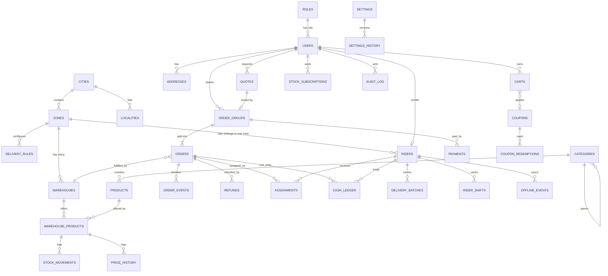

# 01 – Data Model Overview

Status: draft v3 · Depends on: `00-overview.md`. Each collection's fields live in the feature doc that owns it (table in §3).

## 1. Conventions

- MongoDB + Mongoose. Every document has `_id`, `createdAt`, `updatedAt` (omitted in feature docs).
- **Money:** integer paise. **Weight:** integer grams. **Dates:** UTC; business windows evaluated in `Asia/Kolkata`. **Phones:** E.164.
- Operational documents carry `zoneId` and/or `warehouseId`. `vendorId` exists on `products` and `warehouses`, defaulting to the owner.
- **Embed** when owned by the parent and read together; **reference** when shared or queried independently.
- **Snapshots:** orders copy product name, variant label, price, GST and the address at placement.
- Soft delete via `status`/`isActive`; never hard-delete catalog, orders, payments, ledgers.
- Files are referenced by `mediaId` (F24), never by URL.

## 2. ERD

Riders ↔ warehouses is many-to-many via `riders.warehouseIds[]` (all within the rider's zone). Standalone: `jobs`, `otps`, `banners`, `waitlist`, `counters`, `media_files`, `notification_templates`, `notifications`.

## 3. Collection ownership

| Collection | Owner doc | Collection | Owner doc |
|---|---|---|---|
| users, refresh_tokens, device_tokens, otps | F01 | orders, order_groups | F13 |
| roles | F02 | order_events | F14 |
| cities, localities, zones, warehouses | F03 | payments | F15 |
| categories, products | F04 | refunds | F16 |
| warehouse_products, stock_movements, price_history, counters | F05 | assignments, delivery_batches | F18 |
| stock_subscriptions | F07 | riders, rider_shifts | F19 |
| waitlist | F08 | rider_location_trail | F20 |
| addresses | F09 | offline_events | F21 |
| carts, quotes | F10 | cash_ledger | F22 |
| delivery_rules | F11 | notification_templates, notifications, jobs | F23 |
| coupons, coupon_redemptions, banners | F12 | media_files | F24 |
| | | settings, settings_history, audit_log | F25 |

## 4. Key indexes

| Collection | Index | Purpose |
|---|---|---|
| users | `phone` unique | Login |
| zones / warehouses / addresses / riders / localities | 2dsphere | Zone check, distance |
| warehouse_products | `(warehouseId, productId)` unique, `(zoneId, rev)` | Tree, zone catalog, delta sync |
| products | `categoryId+status`, text | Browse, search |
| orders | `(warehouseId, status, createdAt)`, `(riderId, status)`, `(groupId)` | Boards, dispatch |
| order_groups | `(userId, idempotencyKey)` unique, `expiresAt` | Idempotency, expiry |
| assignments | `(status, ackDeadlineAt)` | Ack sweeper |
| offline_events | `clientEventId` unique | Sync idempotency |
| stock_subscriptions | `(zoneId, productId, status)` | Notify Me trigger |
| media_files | `(status, deleteAfter)` | Delete sweeper |
| jobs | `(status, runAt)` | Worker |
| otps / refresh_tokens | TTL | Cleanup |
| payments | razorpay ids unique sparse | Webhook idempotency |

## 5. Integrity rules

1. **Stock deduction** is an atomic `updateOne` with `$gte` on that warehouse's `warehouse_products` row. Multi-line and multi-warehouse orders roll back earlier deductions with compensating `$inc` on failure. Move to Mongo transactions later if all-or-nothing is needed (Atlas replica set).
2. **Idempotency:** `order_groups(userId, idempotencyKey)` unique; webhook ids in `payments.webhookEventIds`; rider events by `clientEventId`.
3. **Single writer of status:** `transition()` updates `orders.status` and writes `order_events` together.
4. **Zone rules:** a warehouse has one `zoneId`; a rider's `warehouseIds` all belong to the rider's `zoneId`; zone polygons do not overlap; one active `delivery_fee` rule per zone.
5. **Price rule:** effective selling price per `(zoneId, productId, variantId)` is identical across warehouses (`zonePriceConflictMode`), checked on edit, bulk edit and import.
6. **Charges lock:** after placement, group `pricing.charges` never increase.
7. **Fee allocation:** the sum of the children's shares equals the group total; the rounding remainder goes to the first child.
8. `riders.activeOrderCount` changes only through assignment and delivery services; nightly reconciliation against `orders`.
9. `cash_ledger.balanceAfter` is computed atomically per rider.
10. Orders, payments, refunds, cash ledger and audit log are append-mostly; no hard deletes.
11. Account deletion anonymises `users` but keeps orders and payments.
12. Delivery OTP: plain code only in `order_groups.deliveryOtpEnc` (server-side decrypt for the customer); riders get salted hashes only; cleared after delivery.
13. Media: removing a file marks it `deleting` and a job deletes every S3 key (F24).
