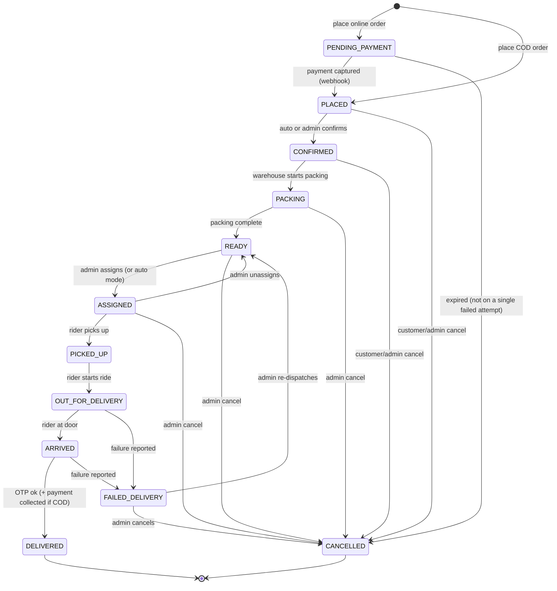
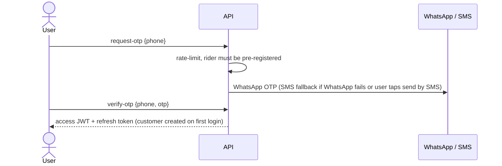
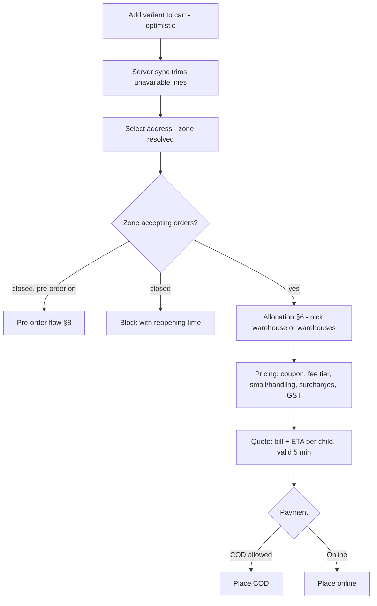
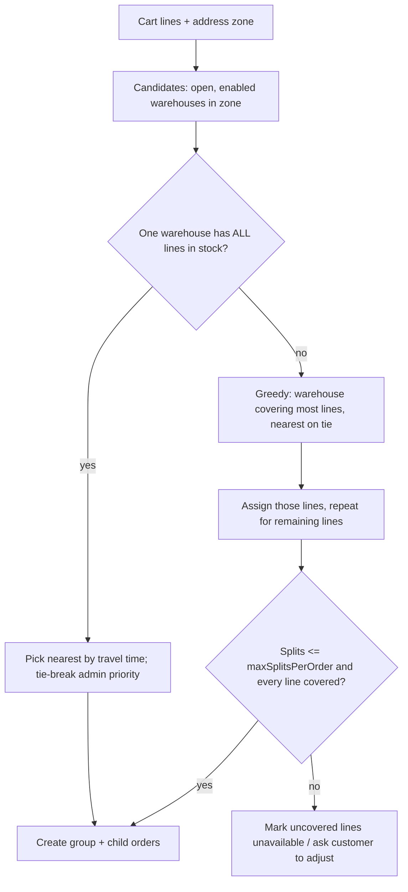
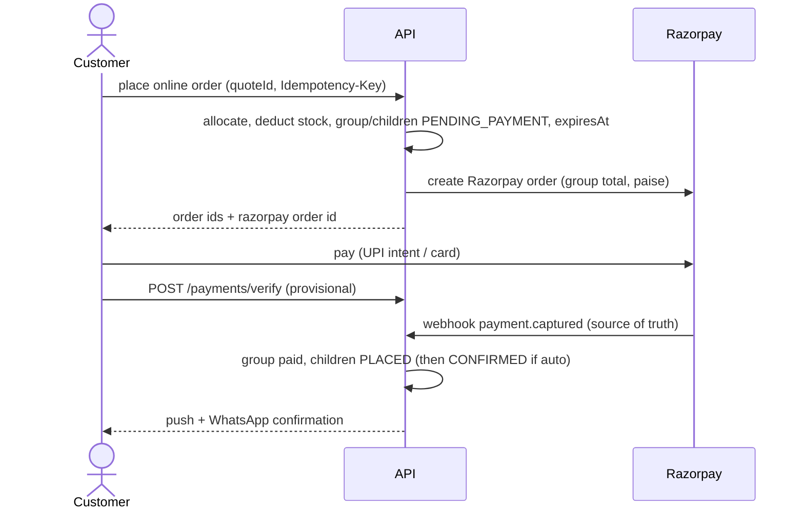
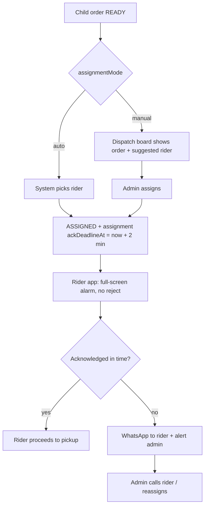
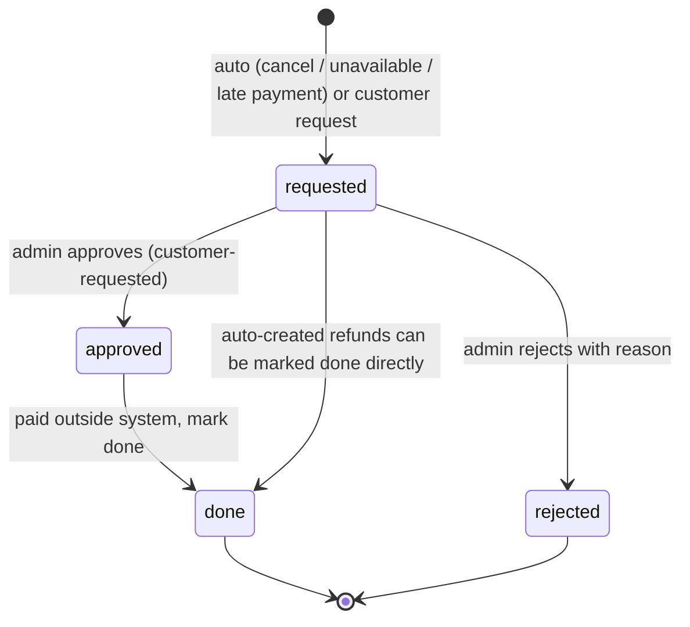
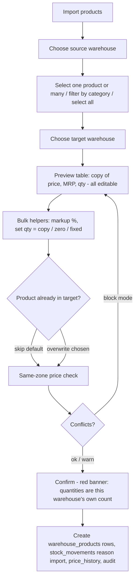

# 02 – Workflows

Status: draft v2 · Depends on: `PLAN.md`, `01-roles-and-actions.md`, `04-delivery-config.md`, `05-offline-and-low-network.md`, `06-media-storage.md`

Conventions: **Actor** = who triggers; **System** = backend/jobs. Every state change writes `order_events` (who, when, from → to, note) and fires notifications from §18. Money is integer paise. Settings in `code` are admin-editable (scope: warehouse → zone → global). All times shown to users are IST.

## 1. Concepts

| Term | Meaning |
|---|---|
| Zone | Polygon where we deliver; has delivery rules; riders belong to one zone |
| Warehouse | Physical stock/packing point; belongs to exactly one zone; a zone has many |
| Order group | One checkout: one customer, one address, one payment, one bill, one delivery fee, one delivery OTP |
| Child order | The part of a group fulfilled by one warehouse. Customer sees each as an order. A normal order is a group with one child |
| Batch | A rider's ordered list of stops (pickups at warehouses, drops at customers) |

## 2. Child order state machine (master)

| Rule | Detail |
|---|---|
| Customer cancel | `PENDING_PAYMENT`, `PLACED`, `CONFIRMED` (`customerCancelUntil`) |
| Admin cancel | Any state before `PICKED_UP`; after that use failed-delivery or handover |
| Terminal | `DELIVERED`, `CANCELLED`; refunds are records, not states |
| Single transition function | `transition(order, to, actor)` is the only writer of `status` |
| Admin override | `orders:manage` can force status with a reason 🔒 |
| Offline delivery | `DELIVERED` with `deliveredOffline=true`; server marks it when the event syncs |
| Single stop shortcut | The rider app's "Picked up & Start ride" runs `PICKED_UP` then `OUT_FOR_DELIVERY` in one tap |

Flags per child: `paymentStatus` (`pending / paid / failed / cod_pending / cod_collected / upi_unverified`), `refundStatus` (`none / pending / done`).

**Group status** is derived: `PENDING_PAYMENT` while unpaid; `ACTIVE` while any child is active; `DELIVERED` when all children delivered; `PARTIAL` if some delivered and others cancelled; `CANCELLED` when all cancelled.

## 3. Login (OTP)

Limits: `otpMaxPerHour` per phone/IP, lockout after max wrong attempts, OTP stored hashed with TTL, 6-digit login OTP. Rider unknown/deactivated → generic "not registered". Admin: email + password (+2FA), lockout on failures.

## 4. Location, zone & catalog resolution

1. App asks for location permission. Allowed → GPS; denied → customer picks city and locality manually (locality has a centre point). **No zone, no prices:** browsing is blocked until a zone is known.
2. `POST /location/resolve {lat,lng | localityId}` → `$geoIntersects` against enabled zones → `zoneId`.
3. No zone → "Coming soon to your area" + waitlist.
4. Zone found → app loads the **zone catalog**: union of products offered by the zone's warehouses (open or not), deduplicated by product. Each product shows one price (guaranteed by the same-price rule) and is *available* if at least one **open** warehouse in the zone has stock.
5. Header ETA range = best open warehouse (04 §6). Zone with no open warehouse → closed or pre-order view (§8).
6. Saved addresses each carry their `zoneId`. Choosing an address in a different zone switches the catalog (§5 step 6).

## 5. Cart, quote & checkout

1. Pricing is server-only (`04` §4). Clients display; the server total is final.
2. **Quote** stores cart snapshot, allocation, `charges[]`, total, ETA per child, `expiresAt` (~5 min). Placing an order requires `quoteId`.
3. If prices, fees or surcharges changed since the quote → `409 QUOTE_CHANGED` + new quote; customer must accept the change.
4. Checks at quote and place time: min order (zone), max items, per-item max qty, COD cap/eligibility, stock, store open/paused.
5. Checkout is a bottom sheet; the customer can pay and finish in a few taps.
6. **Zone change:** when the delivery address belongs to a different zone than the cart was built in, re-price every line against the new zone's catalog, remove or flag unavailable lines (non-blocking), show the new total, and require the customer to confirm before a new quote is issued.

## 6. Allocation & split orders

Allocation runs when a quote is requested and again (authoritatively, with stock locked) when the order is placed.

Rules:
1. Distance = Google Routes travel time (cached per address+warehouse) with fallback to `localities`/warehouse default.
2. A product stocked (same price) in several warehouses goes to the nearest one that can supply the **whole quantity**; a single line is never split between warehouses.
3. `maxSplitsPerOrder` (default 2) protects dispatch; beyond it the cart shows which lines can't be fulfilled together.
4. The customer sees "Your order will arrive in 2 deliveries" with an ETA each; **one bill, one delivery fee, one payment, one OTP**.
5. Per-child shares for refunds/invoices: `itemsSubtotal`, `allocatedDiscount`, `allocatedCharges[]`, `amountDue` (pro-rata by subtotal; rounding remainder to the first child; sums equal the group total).
6. Stock is locked atomically per child at placement (§7). If any child fails, all earlier deductions in the group are rolled back and the customer is told which item is short.

## 7. Place order – COD and online

**COD**
1. Client sends `quoteId` + `Idempotency-Key`.
2. Server re-allocates and re-prices; if it differs from the quote → `409 QUOTE_CHANGED`.
3. Atomic stock deduction per child/line (`$gte` guard; loose items deduct `weightGrams × qty` from that warehouse's gram pool), rollback on failure.
4. Copy the address voice note/house photo into order-owned files (`06` §5); create group (`paymentStatus=cod_pending`) and children `PLACED` with item snapshots, `amountDue`, `promisedAt`, delivery OTP (encrypted at group; salted hash per child for the rider bundle).
5. `orderConfirmMode=auto` → children `CONFIRMED`. Notify customer (push + WhatsApp incl. items, bill, **delivery OTP**, tracking link) and warehouse admins (panel bell via polling + WhatsApp).

**Online (Razorpay)**

| Case | Handling |
|---|---|
| Webhook before client verify | Fine; verify is idempotent |
| Client says success, no webhook | Stay `PENDING_PAYMENT`, UI "confirming payment" until webhook/reconciliation |
| Payment failed | Customer may retry on the same group until `expiresAt`; **only expiry cancels** |
| Not paid by `expiresAt` | Cancel all children, restore stock |
| Duplicate webhook | Ignored via stored event id |
| Amount mismatch | Flag admin, don't confirm |
| Paid after cancel/expiry | Refund record `late_payment` + alert |

## 8. After hours & pre-orders

1. Each warehouse has `hours`; the zone is *accepting* if any warehouse is open and not paused. Late-night delivery = longer hours + night fee (`04` §3).
2. Closed + `afterHoursMode=closed` → browsing only, reopening time shown.
3. Closed + `pre_order` → checkout offers the next windows with remaining capacity ("Tomorrow 7–9 AM"). Allocation uses the stock of warehouses opening for that slot; stock is reserved at placement; capacity per slot is enforced atomically.
4. Pre-order is a normal order with `scheduledWindow`. It stays `CONFIRMED`; at `slotStart − packLeadMinutes` the system surfaces it on the packing list. Dispatch happens inside the window.
5. Cancel allowed until the slot cutoff; online payment taken at order time.
6. Rain/pause states at slot time can still delay; admin notifies from the dispatch board.

## 9. Confirmation & packing (per child, at its warehouse)

1. `PLACED → CONFIRMED`: automatic or admin click.
2. Warehouse staff **Start packing** → `PACKING`.
3. Per line: pack or **mark unavailable** (remove/reduce line, restore that warehouse's stock, recompute bill 🔒, notify customer). Delivery fee and surcharges stay as charged (never raised). Prepaid → refund `requested` for the difference; COD → child `amountDue` updated; all lines unavailable → cancel the child.
4. **Complete packing** → `READY`; print thermal bill/packing slip.
5. Delay alert if a state exceeds `slaMinutes`.
6. Other child orders of the same group proceed independently; the group ETA is the latest child's.

## 10. Dispatch: assignment, acknowledgement, batches

- **Eligible/suggested rider:** active, in the order's zone, allowed at the child's warehouse (`warehouseIds`), on shift, not on break, `activeOrderCount < maxActiveOrders`, recent ping. Rank: fewest active orders → nearest to warehouse → least recently assigned.
- **No rejection.** A rider can `report_problem`; admin decides.
- **Split orders – admin choice** (dispatch board shows both children linked):
  - **Same rider:** one batch, stops: pickup warehouse A → pickup warehouse B → one drop at the customer (one OTP verification delivers both). Shown only if the rider is allowed at both warehouses and under the batch limit.
  - **Different riders:** each child assigned separately; each rider verifies the same group OTP.
- **Batches (general):** admin can group orders (from one or several warehouses of the zone) for one rider, up to `maxActiveOrders` (default 2, max 3), and reorder stops. Rider app shows the stop list; ETA per stop (`04` §6).
- **Reassign:** before `PICKED_UP` freely (old rider's alarm/list updated, 🔒). A manual action cancels any live ack timer.
- **Handover after pickup (breakdown/road block):** admin starts a handover → new rider acknowledges → rider confirms physical hand-over (order status unchanged) → events logged 🔒. If goods can't be handed over, rider returns to the warehouse and the order goes `READY`.

## 11. Pickup, ride & tracking

1. Rider opens the warehouse stop → **pickup checklist** (items verified, bag count) → `PICKED_UP`; the app downloads the offline bundle (`05` §2.2).
2. All pickups of the batch done → **Start ride** → `OUT_FOR_DELIVERY`; customer notified with rider name, phone, tracking link and, for COD, the pay-online link.
3. Rider posts location every ~10 s on an order (~60 s idle online). Offline pings are buffered (`05` §2.6).
4. Customer polls `GET /orders/:id/tracking` → `{status, riderLocation?, lastLocationAt, eta, timeline}` (~10 s when out for delivery); rider location is hidden before pickup and never shows other customers' stops.
5. ETA recalculated by Google Routes every ~60 s or on status change (`04` §6).
6. At the door: **Arrived** → `ARRIVED` (customer notified).

## 12. Delivery, payment at the door, pay-link

1. **OTP** (if `deliveryOtpEnabled`): customer reads the 4-digit code (shown in app and sent on WhatsApp); rider enters it; verified locally and again on the server (`05` §2.3).
2. **Prepaid:** OTP → **Delivered**.
3. **COD:** the app shows `amountDue`; rider chooses:
   - **Cash collected** → ledger `+amount` (child's warehouse), `cod_collected`.
   - **UPI QR** (local, offline-capable) → customer pays → rider taps "Customer paid via UPI" → `upi_unverified`, admin reconciles with the bank; not counted as cash in hand.
4. **Delivered** → `DELIVERED` (or `deliveredOffline=true` with device time + GPS when offline; "Delivered" is notified when it syncs).
5. **Pay-online link for COD:** before cash is collected, the customer can pay the group via Razorpay link/UPI intent. On `payment.captured` the group becomes `paid`, `amountDue=0`, and the rider app gets "Already paid – do not collect". If the rider already collected cash/UPI → entry marked `overpaid`, admin creates a refund.
6. Notify "delivered" + receipt/invoice PDF on WhatsApp. Rating (phase 2).
7. Set `deleteAfter = deliveredAt + 7 days` on the order's voice note and house photo; the sweeper deletes them from S3 (`06` §5).

## 13. Failed delivery & handover

1. Rider taps **Report failed** with reason (customer unreachable, wrong address, refused, **road blocked, weather**, other) + optional photo → `FAILED_DELIVERY`; admin alerted; customer prompted/called.
2. Admin chooses 🔒: **Re-dispatch** (`READY`) or **Cancel & return to stock** (stock restored for goods in good condition `return`, written off for spoiled `wastage`; refund if prepaid).
3. COD: nothing collected, no ledger entry. Repeat failures → `customers:manage` can disable COD for the customer.
4. Split groups: failure of one child doesn't affect the other.

## 14. Cancellation

| Who | When | Result |
|---|---|---|
| Customer | child in `PENDING_PAYMENT`/`PLACED`/`CONFIRMED` | That child `CANCELLED`, its stock restored; prepaid → refund of its item share (see below) |
| Admin | before `PICKED_UP` (incl. `READY`, `ASSIGNED`) | Same, reason required 🔒; live assignment cancelled and rider notified |
| System | unpaid online group past expiry | Cancel all children, restore stock |

**Split groups:** cancelling one child refunds `itemsSubtotal − allocatedDiscount` for that child; delivery fee and surcharges remain (the delivery still happens) unless **all** children are cancelled before dispatch, in which case the whole bill is refunded. Notify customer on every cancel; paid cancellations appear in Pending refunds.

## 15. Refunds (manual)

Created automatically (prepaid cancel, unavailable item, late payment, overpaid) or by the customer within `refundWindowHours`. Admin reviews, pays outside the system (Razorpay dashboard for online, UPI/cash for COD), clicks **Mark refund done** (method, reference, note), order `refundStatus=done`, customer notified 🔒. Refunds link to `groupId` and `orderId`.

## 16. Rider shift & cash ledger

**Shift**
1. **Start shift:** choose current warehouse; geo-tagged punch-in – must be within `punchInRadiusMeters` of the warehouse (outside → allowed but flagged for admin). Blocked if deactivated.
2. Rider may **switch warehouse** mid-shift; admin can override.
3. **Break** → not assigned orders. **End shift** blocked with active orders or unsynced outbox (admin can override); closes the shift row (attendance hours).
4. No ping for N minutes while online → marked offline; admin alerted if on an order.

**Cash ledger (COD)**
1. `collect_cash` creates `+amount` with the order's `warehouseId`.
2. Rider sees cash in hand (total and per warehouse).
3. End of day the rider hands cash over; admin records **deposit** against a warehouse (`cash:manage`) 🔒. With scoped staff, a warehouse manager settles that warehouse's share; owner/`all` scope can settle any.
4. `overpaid` / `unmatched` / `upi_unverified` items appear in a reconciliation list; corrections via adjustment entries with reason 🔒.

## 17. Stock, Notify Me & stock events

| Event | Stock effect (that warehouse) | Movement reason |
|---|---|---|
| Order placed (COD or online pending) | Deduct, atomic | `order` |
| Cancelled / expired / item unavailable | Restore | `cancel` |
| Failed delivery returned | Restore | `return` |
| Failed delivery spoiled | No restore | `wastage` |
| Admin adjustment | ± with reason | `purchase` / `correction` / `wastage` |
| Stock-take | Set to counted | `count` |
| Product imported with quantity | Set initial | `import` |

Loose products (`pooled_weight`) deduct grams; packaged deduct units. Below `lowStockThreshold` → admin alert; at 0 the item is unavailable in that warehouse.

**Notify Me:** customer taps 🔔 on an out-of-stock product → `stock_subscriptions` (per zone). When zone availability goes 0 → >0 (any warehouse), subscribers receive push + WhatsApp (image + deep link), then the subscription closes. Throttled, one message per subscription. Admin "Demand list" shows count per product/zone.

## 18. Notification matrix

| Event | Customer | Rider | Admin |
|---|---|---|---|
| Login OTP | WhatsApp (SMS fallback) | same | – |
| Order placed/confirmed | Push + WhatsApp (items, bill, **delivery OTP**, tracking link) | – | Bell + WhatsApp (warehouse admins) |
| Split into 2 deliveries | in the above | – | – |
| Item unavailable / bill changed | Push + WhatsApp | – | – |
| Assigned | Push | **Full-screen alarm**; WhatsApp if not acked in 2 min | Alert if not acked |
| Out for delivery | Push + WhatsApp (rider name/phone, tracking link, pay-online link if COD) | – | – |
| Arrived | Push | – | – |
| Delivered | Push + WhatsApp (receipt PDF) | – | – |
| Offline delivery flagged / OTP mismatch | – | – | Alert |
| Failed delivery | Push | – | Alert |
| Cancelled | Push + WhatsApp | Push if assigned | – |
| Refund created/approved/rejected/done | Push + WhatsApp | – | Pending-refund badge |
| Back in stock (Notify Me) | Push + WhatsApp | – | – |
| Abandoned cart (30 min, opt-in) | Push + WhatsApp (optional) | – | – |
| Payment mismatch / late payment / overpaid | – | – | Alert |
| Low stock / delayed order | – | – | Alert |
| Daily 20:00 digest | – | – | Owner WhatsApp |
| Promo broadcast | Push (opt-in) | – | – |

All through `jobs` with retries and a delivery log; templates admin-editable; OTP via WhatsApp/SMS. WhatsApp marketing (abandoned cart, promos) needs opt-in and an approved marketing template.

## 19. Settings change

1. Admin opens a group/scope (global, zone or warehouse) → edits → backend validates (types, ranges, tiers without gaps, dependencies).
2. Save writes a new version, `settings_history` + `audit_log` 🔒; cache refreshes immediately; effective on the next request/job (existing quotes keep their locked values until expiry).
3. Fee-affecting changes show a **preview** first. Secrets are not editable here.

## 20. Warehouse catalog, tree & import (admin)

**Product tree view**
1. Admin picks a warehouse (scoped users only see theirs) → tree: **Category → Product → Variants**.
2. Columns: price, MRP, sale price, quantity (grams for loose), on/off. Edit inline or select many and bulk-edit (set, ±%, ±amount; set/add quantity).
3. Every edit writes `price_history` / `stock_movements` / audit and bumps the row `rev` (customers get it via delta sync). Concurrent edits use `rev` as an optimistic lock.
4. **Same-zone price rule:** saving a price that differs from the same product in another warehouse of the **same zone** is blocked (`zonePriceConflictMode=block`) or warned (`warn`); the dialog offers "apply to the other warehouse too". Prices in warehouses of other zones are independent.

**Import from another warehouse**

- Copies: product link, variants, images, price, MRP, sale price, quantity. All changeable before saving. Source is untouched; there is **no ongoing sync and no stock transfer**.
- Default quantity mode is **copy** (as requested); the preview flags quantities in red and requires an explicit confirm because copied quantities create "paper stock" until corrected. `zero` and `fixed` modes are one click away.
- Importing into a warehouse in the **same zone** applies the price rule; into another zone prices can differ.
- A product not in the master catalog can't be imported; create it in the master catalog first.

## 21. Admin day-to-day

| Time | Flow |
|---|---|
| Open | Dashboard, low stock, pending refunds, unreconciled UPI; end "pause" if used; check rain mode; riders punch in |
| Live | New-order bell (board polls every ~5 s) → (confirm) → pack → ready → assign / batch (choose same or different rider for split orders) → watch ack status and delays |
| Weather | `ops_mode:manage` toggles rain mode with an end time |
| Close | Resolve failed deliveries, review offline deliveries, record cash deposits per warehouse, reconcile UPI, mark refunds done, stock-take; 20:00 owner digest arrives |

## 22. Open points

1. Packing station: one shared admin device or a login per packer (future Packer role scoped by warehouse)? Deferred.
2. Rider cash-in-hand limit that blocks new assignments? Default none; possible setting.
3. Invoices: per warehouse GSTIN and sequence, and GST on fees (CA). Default one invoice per child using `orderNo`.
4. Route ordering for multi-stop batches is manual in Phase 2; automatic later.
5. Maximum distance between warehouses for a same-rider split batch (practical limit)? Default admin judgement.
