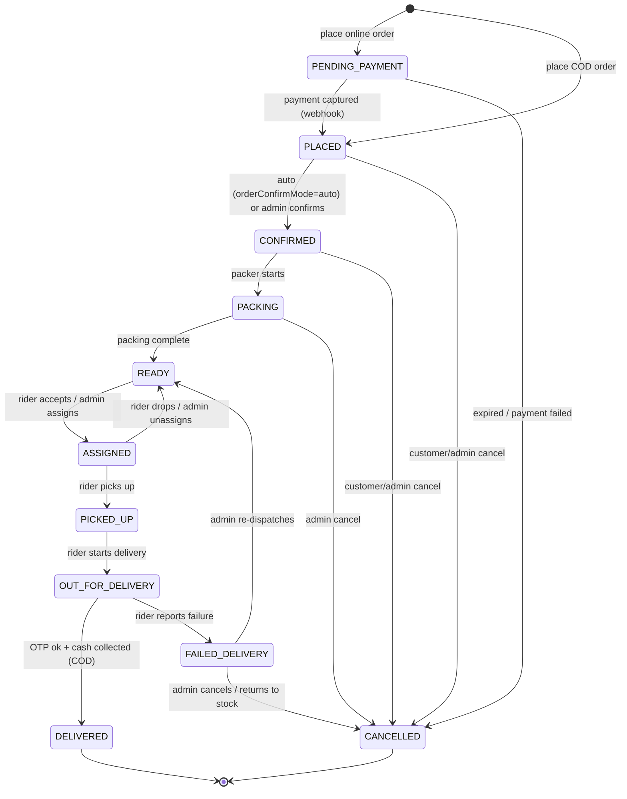
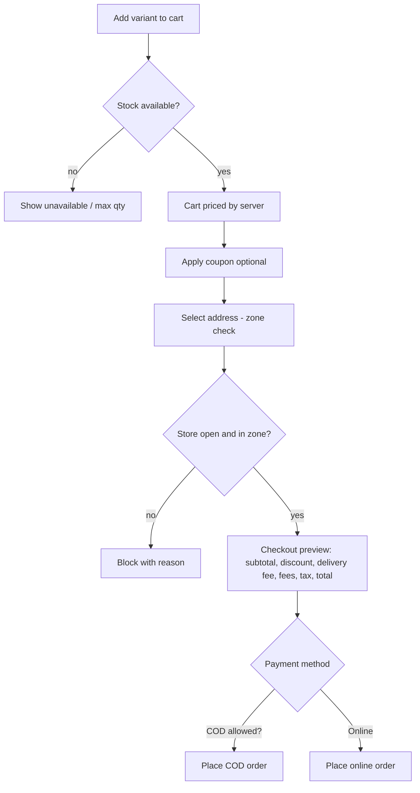
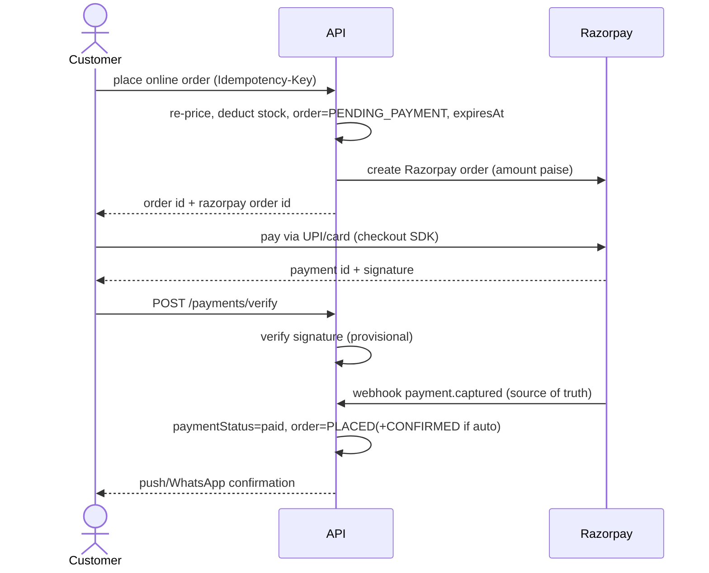
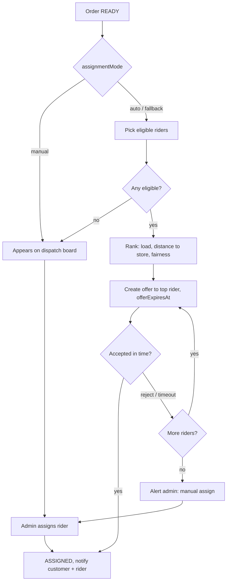
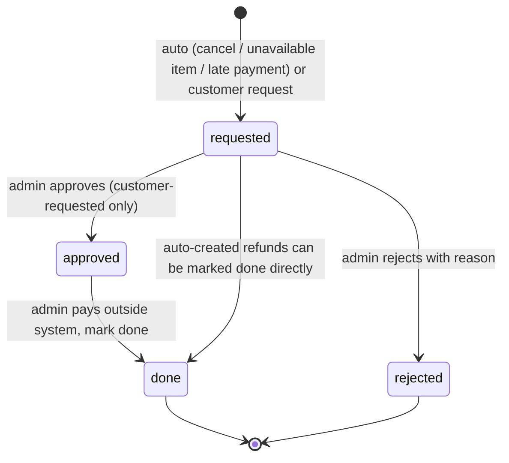

# 02 – Workflows

Status: draft v1 · Depends on: `PLAN.md`, `01-roles-and-actions.md`

Conventions: **Actor** = who triggers; **System** = backend/jobs. Every state change writes `order_events` (who, when, from → to, note) and fires notifications from §14. Money is integer paise. Settings named in `code` are admin-editable.

## 1. Order state machine (core)



| Rule | Detail |
|---|---|
| Customer cancel | Allowed only in `PENDING_PAYMENT`, `PLACED`, `CONFIRMED` (before `PACKING`; setting `customerCancelUntil`) |
| Admin cancel | Any state before `PICKED_UP`; after that use failed-delivery flow |
| Terminal states | `DELIVERED`, `CANCELLED` – no further transitions except refund records |
| Invalid transitions | Rejected by one `transition(order, to, actor)` function (single place) |
| Admin override | `orders:manage` can force status with mandatory reason 🔒 |

Order has separate flags: `paymentStatus` (`pending / paid / failed / cod_pending / cod_collected`) and `refundStatus` (`none / pending / done`).

## 2. Login (OTP)

```mermaid
sequenceDiagram
    actor U as User (customer/rider)
    participant A as API
    participant S as SMS/WhatsApp
    U->>A: POST /auth/request-otp {phone}
    A->>A: rate-limit; rider phone must be pre-registered
    A->>S: send OTP (stored hashed, TTL)
    U->>A: POST /auth/verify-otp {phone, otp}
    A->>A: check attempts, expiry
    A-->>U: access JWT + refresh token (create customer on first login)
```

| Step | Rules |
|---|---|
| Request | Max N per phone/hour and per IP (`otpMaxPerHour`); 429 beyond |
| Verify | OTP length/expiry/attempts from settings; lock phone after max wrong attempts |
| Rider | Unknown phone → generic "not registered" (no user enumeration detail); deactivated rider rejected |
| Customer first login | Create user with role `customer`; ask name + address afterwards |
| Admin | Email + password (+2FA); separate endpoint; lockout after repeated failures |
| Tokens | Short access JWT, refresh token stored hashed; logout/deactivate revokes |

## 3. Browse, address & zone check

1. Guest opens app/web → `store:view_status` (open/closed, pause flag, fees).
2. Browse categories/products/search; only `active` products with stock shown (out-of-stock visibility from setting).
3. At checkout (or "add address"): customer drops a pin (Google Maps + Places) → `POST /zones/check {lat,lng}` → `$geoIntersects` against enabled zones.
4. Inside zone → address saved as deliverable, zone fee/min order applied. Outside → "not delivering here yet" (optional waitlist).
5. Store closed or `pauseOrders=true` → browsing allowed, checkout blocked with message and reopening time.

## 4. Cart & checkout



**Pricing rules (one `pricing` module, server-side only):**
1. Line total = variant price × qty (current price snapshotted at order time).
2. Discount: coupon/offers validated (min order, max discount, per-user limit, first-order, validity).
3. Delivery fee by `deliveryFeeMode` (`flat` / `distance`) and `freeAbove` threshold; plus `smallOrderFee`, `handlingFee`.
4. Tax per `gstRate`, inclusive/exclusive from settings.
5. Checks at place time: min order, max items, per-item max qty, COD cap/eligibility (customer flag, zone, amount), stock.
6. Client totals are display-only; the server's total is final.

## 5. Place order – COD

1. Client sends cart + address + `Idempotency-Key`.
2. Server re-prices, validates (§4), then **atomically deducts stock** per line (`updateOne` with `$gte`; for loose items deduct `weightGrams × qty` from the product's gram pool). Any line fails → roll back earlier deductions, return which item is short.
3. Create order `PLACED`, `paymentStatus=cod_pending`, items snapshot (name, variant label, price, qty, GST).
4. Write `stock_movements` (reason `order`), `order_events`.
5. If `orderConfirmMode=auto` → `CONFIRMED` immediately.
6. Notify customer (push + WhatsApp "order confirmed"); notify admin (new order alert).

## 6. Place order – online (Razorpay)



| Case | Handling |
|---|---|
| Webhook before client verify | Fine; order already moved, verify call is idempotent |
| Client says success, no webhook | Order stays `PENDING_PAYMENT` until webhook or reconciliation; UI shows "confirming payment" |
| Payment failed | `payment.failed` → customer may **retry** (`payment:retry`) with a new Razorpay attempt on same order until `expiresAt` |
| Not paid by `expiresAt` (`onlineOrderExpiryMinutes`) | Job cancels order, **restores stock** |
| Duplicate webhook | Ignored via stored event id / idempotent state check |
| Amount mismatch | Flag for admin, do not confirm |
| Paid after cancel/expiry | Create refund record (`requested`, reason "late payment") and alert admin |

## 7. Order confirmation & packing

1. `PLACED` → `CONFIRMED`: automatic or admin click per `orderConfirmMode`.
2. Packer/admin opens order → **Start packing** → `PACKING` (records who).
3. For each line: pack or **mark unavailable**:
   - Unavailable line: remove/reduce line, restore its stock, recompute bill 🔒, notify customer "item X unavailable".
   - If prepaid: auto-create refund `requested` for the difference. If COD: rider collects the new total.
   - If all lines unavailable → cancel order.
4. **Complete packing** → `READY` (print packing slip/invoice). Triggers assignment (§8).
5. Delayed-order alert if an order sits in a state beyond `slaMinutes` per state.

## 8. Rider assignment (manual / auto / auto_with_fallback)



| Rule | Detail |
|---|---|
| Eligible rider | Active, on shift (online), not on break, active orders < `maxActiveOrders`, recent location ping |
| Ranking | Fewest active orders → nearest to store (Google distance or straight-line) → least recently assigned |
| Offer | One rider at a time; `offerTimeoutSeconds`; sweeper (~10 s) expires offers and moves on, survives restarts since state is in Mongo |
| Rider rejects | Offer closed, rider skipped for this order |
| Admin | Can assign/reassign any time before `PICKED_UP`; manual action cancels any live offer 🔒 |
| Reassign | `ASSIGNED` → another rider; previous rider notified and order removed from their list |
| Rider drops | Rider "can't deliver" before pickup → back to `READY`, re-offered |
| Batching | Rider may hold up to `maxActiveOrders` simultaneously |

## 9. Pickup, delivery & tracking

1. **Rider app** – order in "My orders" → navigate to store → **Picked up** (`PICKED_UP`).
2. **Start delivery** → `OUT_FOR_DELIVERY`; customer notified with tracking link (push + WhatsApp).
3. Rider app POSTs location every ~10 s while it has an active order (`rider_location:update`); backend updates `riders.lastLocation`.
4. Customer app/web polls `GET /orders/:id/tracking` → `{status, riderLocation, eta, timeline}`: ~5 s when out for delivery, ~15–30 s before; stop on terminal state/background.
5. ETA = Google Routes (rider → address) cached per poll interval, plus buffer.
6. At the door:
   - If `deliveryOtpEnabled`: customer shows OTP (visible in order screen) → rider enters → verified.
   - COD: rider confirms **cash collected** for exact amount → `cash_ledger` entry, `paymentStatus=cod_collected`.
   - Rider taps **Delivered** → `DELIVERED`.
7. Notify customer "delivered" (+ receipt link); rating prompt (phase 2).

## 10. Failed delivery

1. Rider taps **Report failed delivery**: reason (customer unreachable / wrong address / refused / other) + optional photo + note → `FAILED_DELIVERY`.
2. Admin alerted; customer gets a call attempt prompt/notification.
3. Admin chooses (🔒):
   - **Re-dispatch** → back to `READY` (rider may retry later).
   - **Cancel & return to stock** → `CANCELLED`; items checked in (`stock_movements` reason `return`) or written off as wastage (perishables); refund created if prepaid.
4. COD cash: none collected, so no ledger entry. Repeat failures can lead to `customers:manage` → COD disabled for that customer.

## 11. Cancellation

| Who | When | Result |
|---|---|---|
| Customer | `PENDING_PAYMENT`, `PLACED`, `CONFIRMED` | Order `CANCELLED`, stock restored; prepaid → refund `requested` (auto-created) |
| Admin | Before `PICKED_UP` | Same, with reason required 🔒 |
| System | Online order unpaid past expiry | Cancel + restore stock |

Notify customer on every cancel (push + WhatsApp). Cancelled paid orders appear in the pending-refunds list.

## 12. Refunds (manual)



1. **Created** automatically (prepaid cancellation, unavailable item, late payment) or by the customer (`refund:request`: item, reason, photo if `refundPhotoRequired`) within `refundWindowHours` after delivery and for allowed categories.
2. Admin reviews in **Pending refunds** list (amount, reason, photos, order).
3. Customer-requested: approve or reject with reason (notify customer).
4. Admin pays back **outside the system**: Razorpay dashboard refund for online orders, UPI/cash for COD.
5. Admin clicks **Mark refund done**: method, reference id, note → `done`, order `refundStatus=done`, `markedBy/markedAt` 🔒; customer notified (push + WhatsApp).
6. Window expired → request blocked in app (or auto-rejected per setting).

## 13. Rider shift & cash ledger

**Shift**
1. Rider opens app → **Start shift** (online) → eligible for offers, location pings begin. Blocked if deactivated.
2. **Break** → not offered orders; **End shift** → blocked if active orders remain; otherwise offline and shift row closed (attendance hours).
3. No ping for N minutes while online → system marks offline and alerts admin.

**Cash ledger (COD)**
1. Each `rider_order:collect_cash` creates ledger entry `+amount` (order id).
2. Rider sees "cash in hand" = collected − deposited.
3. End of day: rider hands cash to store; admin **records deposit** (`cash:manage`) → entry `−amount`, signed by admin 🔒.
4. Differences shown on dashboard; corrections via adjust entry with reason 🔒.

## 14. Notification matrix

| Event | Customer | Rider | Admin |
|---|---|---|---|
| Order placed/confirmed | Push + WhatsApp | – | Push/alert (new order) |
| Item unavailable / bill changed | Push + WhatsApp | – | – |
| Packing done | – | – | – |
| Offer created | – | Push (high priority) | – |
| Assigned | Push | Push | – |
| Out for delivery | Push + WhatsApp (tracking link) | – | – |
| Delivered | Push + WhatsApp (receipt) | – | – |
| Failed delivery | Push | – | Alert |
| Cancelled | Push + WhatsApp | Push if assigned | – |
| Refund created/approved/rejected/done | Push + WhatsApp | – | Pending-refund badge |
| Payment mismatch / late payment | – | – | Alert |
| Low stock | – | – | Alert |
| Unaccepted offers / delayed order | – | – | Alert |
| Promo broadcast | Push (opt-in) | – | – |

All sends go through the `jobs` collection with retries and a delivery log; templates are admin-editable. OTP uses SMS (WhatsApp OTP optional).

## 15. Stock rules (summary)

| Event | Stock effect | Movement reason |
|---|---|---|
| Order placed (COD or online pending) | Deduct (atomic `$gte` guard) | `order` |
| Order cancelled / expired / item unavailable | Restore | `cancel` |
| Failed delivery returned, goods fine | Restore | `return` |
| Failed delivery, goods spoiled | No restore | `wastage` |
| Admin adjustment | ± with reason | `purchase` / `correction` / `wastage` |
| Stock-take | Set to counted, difference logged | `count` |

Loose products (`stockMode=pooled_weight`) deduct `weightGrams × qty` from one gram pool; packaged products (`per_variant`) deduct units. When stock falls below `lowStockThreshold`, alert admin; at 0 the product/variant shows unavailable.

## 16. Admin settings change

1. Admin opens a settings group (`settings:manage`) → edits → backend validates (types, ranges, dependencies e.g. COD cap ≥ 0).
2. Save writes new version, `settings_history` + `audit_log` (who, old → new) 🔒.
3. In-memory cache refreshes immediately; takes effect on the next request/job.
4. Secrets (Razorpay, WhatsApp, Google, Cloudinary keys) are not editable here.

## 17. Admin day-to-day (reference)

| Time | Flow |
|---|---|
| Open | Check dashboard, low stock, pending refunds; end "pause orders" if used |
| Live | New order → (confirm) → pack → ready → auto/manual assign → watch dispatch board/alerts |
| Close | Resolve failed deliveries, record rider cash deposits, mark refunds done, stock-take if needed |

## 18. Open points

1. Delivery fee `distance` mode: use Google Routes distance per order (adds API cost) or straight-line? Launch is `flat`, so deferred.
2. Packing station: does packing happen in the admin panel on one device, or does each packer need their own login (affects future Packer role)? Deferred; one `admin` role at launch.
3. Rider "cash in hand" limit that blocks new offers? (Default: no limit; could be a setting later.)
