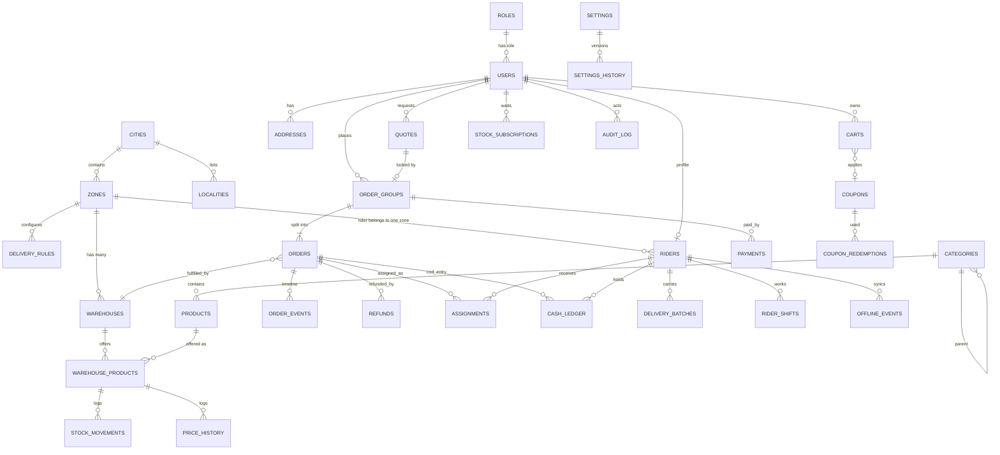

# 03 – Data Model (ERD)

Status: draft v2 · Depends on: `PLAN.md`, `01-roles-and-actions.md`, `02-workflows.md`, `04-delivery-config.md`, `05-offline-and-low-network.md`, `06-media-storage.md`

## 1. Conventions

- MongoDB + Mongoose. Every document has `_id`, `createdAt`, `updatedAt` (omitted below).
- **Money:** integer paise. **Weight:** integer grams. **Dates:** UTC (business windows evaluated in `Asia/Kolkata`). **Phones:** E.164.
- Operational documents carry `zoneId` and/or `warehouseId` (no more global `storeId`). `vendorId` exists on `products` and `warehouses`, defaulting to the owner, for a later marketplace.
- **Embed** when owned by the parent and read together; **reference** when shared or queried independently.
- **Snapshots:** orders copy product name, variant label, price, GST and the address at placement.
- Soft delete via `status`/`isActive`; never hard-delete catalog, orders, payments, ledgers.
- Enums are strings.

## 2. ERD

Riders ↔ warehouses is many-to-many via `riders.warehouseIds[]` (all within the rider's zone). Standalone: `jobs`, `otps`, `banners`, `waitlist`, `counters`, `notification_templates`, `notifications`.

## 3. Identity & access

### roles
`name` (unique), `permissions` string[] (keys from `01`; `*` = all), `isSystem`.

### users
| Field | Type | Notes |
|---|---|---|
| roleId | ref | One role per user |
| phone | string | E.164, unique sparse |
| email, passwordHash, twoFactor | | Staff only |
| name | string | |
| status | enum | `active, blocked, deactivated, deletion_requested, deleted` |
| scope | {all: bool, warehouseIds: ref[]} | **Staff data scope**, enforced on every admin query |
| codAllowed | bool | |
| notificationPrefs | {promoPush, promoWhatsApp, cartReminders} | Transactional always on; reminders opt-in |
| lastLoginAt, defaultAddressId, internalNotes, blockedReason | | |

Indexes: `phone` unique sparse, `email` unique sparse, `roleId`.

`refresh_tokens` (`userId`, `tokenHash`, `deviceInfo`, `expiresAt` TTL, `revokedAt?`) · `device_tokens` (`userId`, `fcmToken` unique, `platform`, `app` customer/rider, `lastSeenAt`) · `otps` (`phone`, `otpHash`, `purpose`, `attempts`, `expiresAt` TTL, `channel`).

## 4. Geography & warehouses

### cities
`name`, `state`, `isActive`.

### localities
`cityId`, `name` (area/busty/road dropdown value), `location` (centre Point), `zoneId?`, `travelMinutes?` (default ETA override), `isActive`, `sortOrder`.

### zones
| Field | Type | Notes |
|---|---|---|
| name, cityId | | |
| polygon | GeoJSON Polygon | **2dsphere**; overlap with another enabled zone is rejected on save |
| isEnabled | bool | |
| pause | {active, message, until?}? | Ops pause for the whole zone |

Fee, min-order and surcharge configuration lives in `delivery_rules` (see `04`).

### warehouses
| Field | Type | Notes |
|---|---|---|
| name, code | string | |
| vendorId | ref | Defaults to owner |
| zoneId | ref | **Exactly one zone**; many warehouses may share a zone |
| location | Point | 2dsphere; used for distance/punch-in |
| address | embedded | |
| isEnabled | bool | |
| priority | int | Tie-break in allocation (lower first) |
| hours | [{days, open, close}] | IST |
| lastOrderMinutesBeforeClose | int | |
| afterHoursMode | enum | `closed`, `pre_order` |
| preOrder | {enabled, slots[{start,end,capacity}], cutoffMinutesBeforeSlot}? | |
| packMinutes, riderArrivalMinutes | int? | "Grace time"; fall back to settings |
| defaultTravelMinutes | int? | ETA fallback |
| upi | {vpa, payeeName}? | Business VPA for local QR (audited) |
| pause | {active, message, until?}? | |
| punchInRadiusMeters | int? | |

Indexes: `zoneId`, `location` 2dsphere.

## 5. Customer data

### addresses
| Field | Type | Notes |
|---|---|---|
| userId | ref | |
| label | string | |
| line1, cityId, localityId, pincode | | Locality required |
| landmark | string | **Required** |
| contactName, contactPhone | | |
| location | Point | 2dsphere; GPS accuracy stored in `locationAccuracyM` |
| zoneId | ref? | Resolved on save |
| isDeliverable | bool | |
| voiceMediaId | ref media_files? | ≤ 10 s; customer-controlled; order gets its own copy (`06`) |
| housePhotoMediaId | ref media_files? | |
| deliveryNotes | string? | |

### waitlist
`userId?`, `phone`, `location`, `localityId?`.

### stock_subscriptions
`userId`, `zoneId`, `productId`, `variantId?`, `channels` [push, whatsapp], `status` (`waiting, notified, cancelled`), `notifiedAt?`. Unique `(userId, zoneId, productId, variantId)` while `waiting`; index `(zoneId, productId, status)`.

## 6. Catalog

### categories
`name`, `slug` unique, `parentId?`, `imageMediaId?`, `sortOrder`, `isActive`.

### products (master – no price, no stock)
| Field | Type | Notes |
|---|---|---|
| vendorId | ref | Defaults to owner |
| name, slug (unique), description | | Admin warns on duplicate names |
| categoryId | ref | |
| tags, images[{mediaId, alt, sortOrder}] | | `mediaId` → `media_files` (S3 keys); removing an image deletes it from S3 |
| type | enum | `loose`, `packaged` |
| stockMode | enum | `pooled_weight`, `per_variant` |
| variants | embedded[] | `{_id, label, weightGrams, sku (unique), barcode?, isActive}` |
| gstRate, hsnCode | | |
| status | enum | `active, inactive, archived` |
| sortOrder | int | |

Indexes: `slug` unique, `categoryId+status`, `variants.sku` unique sparse, text on `name`/`tags`.

### warehouse_products (the thing customers buy)
| Field | Type | Notes |
|---|---|---|
| warehouseId, productId | ref | **Unique `(warehouseId, productId)`** |
| zoneId | ref | Denormalised from the warehouse (zone catalog queries) |
| status | enum | `active, inactive, archived` (also acts as tombstone for delta sync) |
| stockGrams | int? | Pool when `pooled_weight` |
| variants | embedded[] | `{variantId, price, mrp, salePrice?, saleStart?, saleEnd?, stock? (units, per_variant), maxQtyPerOrder?, isActive}` |
| isOutOfStockOverride | bool | |
| rev | int | From `counters`, bumped on every change; delta sync cursor |
| importedFrom | {warehouseId, at, by}? | Audit of import (no ongoing link) |

Indexes: unique `(warehouseId, productId)`, `(zoneId, rev)`, `(zoneId, productId)`, `(warehouseId, status)`.
Integrity: for the same `(zoneId, productId, variantId)` the effective selling price must match across warehouses (`zonePriceConflictMode`).

### stock_movements
`warehouseId`, `productId`, `variantId?`, `mode` (`grams`/`units`), `delta`, `balanceAfter`, `reason` (`order, cancel, return, purchase, correction, wastage, count, import`), `orderId?`, `note?`, `by?`. Index `(warehouseId, productId, createdAt)`.

### price_history
`warehouseId`, `productId`, `variantId`, `old/new price`, `old/new mrp`, `by`, `at`.

### banners
`title`, `imageMediaId`, `link`, `zoneId?` (null = all), `sortOrder`, `startsAt?`, `endsAt?`, `isActive`.

### media_files (S3 objects; see `06-media-storage.md`)
| Field | Type | Notes |
|---|---|---|
| kind | enum | `product_image, category_image, banner, rider_photo, address_voice, address_photo, order_voice, order_photo, failed_delivery_photo, refund_photo` |
| ownerType, ownerId | | e.g. `product`/id, `order`/id |
| keys | [{width?, key, bytes}] | S3 keys of every variant; deleted together |
| contentType | string | |
| status | enum | `pending, ready, deleting, deleted` |
| deleteAfter | date? | Set for order media and evidence photos; sweeper deletes when due |
| copiedFromId | ref? | Order copy of an address file |
| uploadedBy | ref | |
| deletedAt | date? | |

Indexes: `(status, deleteAfter)`, `(ownerType, ownerId)`.

### counters
`_id` (e.g. `catalogRev`, `orderNo`), `value`. Incremented atomically.

## 7. Pricing & rules

### delivery_rules
| Field | Type | Notes |
|---|---|---|
| zoneIds | ref[] | A rule may cover several zones (surcharges) |
| type | enum | `delivery_fee`, `surcharge` |
| kind | enum? | For surcharges: `rain`, `late_night`, `other` |
| isActive | bool | |
| activeUntil | date? | Rain mode auto-off |
| alwaysFree | bool? | Fee rule |
| minOrder | int? | Paise |
| feeBasis | enum? | `afterDiscount`, `beforeDiscount` |
| tiers | [{from, to?, fee}]? | Fee rule; must cover 0..∞ |
| window | {start, end, tz, days}? | Night window, may cross midnight |
| amount, extraMinutes | int? | Surcharge |
| waivedByFreeDelivery | bool? | |

Index `(type, isActive)`, `zoneIds`. One active `delivery_fee` rule per zone (validated).

### coupons
`code` unique, `type` (`percent`, `flat`, `free_delivery`), `value`, `maxDiscount?`, `minOrder`, `perUserLimit`, `totalLimit?`, `usedCount`, `firstOrderOnly`, `zoneIds?`, `warehouseIds?`, `startsAt`, `endsAt`, `isActive`. `coupon_redemptions`: `couponId`, `userId`, `orderGroupId`, `discountAmount`, `at`; unique `(couponId, orderGroupId)`.

### carts
`userId` unique, `items[{productId, variantId, qty}]` (no prices), `couponCode?`, `addressId?`, `zoneId?`, `clientRev`, `updatedAt`, `reminderSentAt?`. Server-synced for reminders and zone-change re-pricing.

### quotes
| Field | Notes |
|---|---|
| userId, addressId, zoneId | |
| cart | Snapshot of lines |
| allocation | `[{warehouseId, lines[]}]` |
| pricing | `{subtotal, discount, charges[], tax, total, taxInclusive}` |
| etas | `[{warehouseId, packMin, arrivalMin, travelMin, extraMin, promisedAt}]` |
| scheduledWindow? | For pre-orders |
| expiresAt | TTL ~5 min after use |
| usedByGroupId? | |

## 8. Orders & payments

### order_groups
| Field | Type | Notes |
|---|---|---|
| groupNo | string unique | e.g. `DS-240001` |
| userId | ref | |
| zoneId | ref | |
| address | embedded snapshot | `{line1, landmark, locality, city, pincode, contactName, contactPhone, location, deliveryNotes?}`; voice note and house photo are order-owned copies referenced by `orders.voiceMediaId` / `housePhotoMediaId` |
| paymentMethod / paymentStatus | enum | `cod`/`online`; `pending, paid, failed, cod_pending, cod_collected` |
| pricing | embedded | `{subtotal, discount, charges[{type,label,amount,ruleId}], tax, total, taxInclusive}` – **one bill for the whole group** |
| couponCode | string? | |
| quoteId | ref | |
| deliveryOtpEnc | string | Encrypted 4-digit OTP shown to the customer; never sent to riders |
| expiresAt | date? | Online expiry |
| idempotencyKey | string | Unique per `(userId, key)` |
| childOrderIds | ref[] | |
| status | enum | Derived roll-up (see `02` §2) |
| source | enum | `app`, `web` |
| trackingToken | string | For expiring public tracking link |

Indexes: `groupNo` unique, `(userId, createdAt)`, `(userId, idempotencyKey)` unique, `expiresAt`.

### orders (child orders – one per warehouse)
| Field | Type | Notes |
|---|---|---|
| orderNo | string unique | Equals `groupNo` when single; `groupNo-A`, `-B` when split |
| groupId, userId, zoneId, warehouseId | ref | |
| status | enum | `PENDING_PAYMENT, PLACED, CONFIRMED, PACKING, READY, ASSIGNED, PICKED_UP, OUT_FOR_DELIVERY, ARRIVED, DELIVERED, CANCELLED, FAILED_DELIVERY` |
| paymentStatus | enum | `pending, paid, failed, cod_pending, cod_collected, upi_unverified` |
| refundStatus | enum | `none, pending, done` |
| items | embedded[] | `{productId, variantId, name, variantLabel, weightGrams, unitPrice, qty, lineTotal, gstRate, hsnCode, status ok/unavailable, unavailableReason?}` |
| itemsSubtotal | int | |
| allocatedDiscount | int | Pro-rata share |
| allocatedCharges | [{type, amount}] | Pro-rata share of fees/surcharges (refund/invoice use) |
| amountDue | int | COD amount for this child (0 if prepaid) |
| riderId, batchId | ref? | Current assignment |
| deliveryOtp | {salt, hash, algo}? | Per-child salted hash for the offline bundle |
| scheduledWindow | {start, end}? | Pre-order |
| etaBreakdown | {packMin, arrivalMin, travelMin, extraMin} | |
| promisedAt | date | |
| timestamps | | `placedAt, confirmedAt, packedAt, pickedUpAt, outForDeliveryAt, arrivedAt, deliveredAt, cancelledAt` |
| delivery | {offline, deviceTime, gps, accuracyM, syncedAt, otpVerifiedLocal, otpVerifiedServer, flags[] (`otp_mismatch, far_from_address, time_skew`), reviewStatus} | Offline-delivery audit |
| collection | {method (`cash, upi_unverified, upi_verified, online`), amount, at, flags[] (`overpaid, unmatched`)}? | |
| cancel | {by, reason}? | |
| voiceMediaId, housePhotoMediaId | ref media_files? | Copies made at placement; **deleted 7 days after delivered/closed** (`06` §5) |
| failedDelivery | {reason, photoMediaId?, note, at}? | Reasons include `road_blocked`, `weather` |
| notes | [{text, by, at}] | Internal |

Indexes: `orderNo` unique, `(groupId)`, `(warehouseId, status, createdAt)`, `(userId, createdAt)`, `(riderId, status)`, `(batchId)`, `(scheduledWindow.start)`.

### order_events
`orderId`, `groupId`, `type` (`status_change, item_unavailable, rider_assigned, ack, handover, note, …`), `from?`, `to?`, `actor` `{userId?, role, system}`, `meta`, `at`. Index `(orderId, at)`.

### payments
| Field | Notes |
|---|---|
| groupId | Payments are per group |
| method | `razorpay`, `cod`, `razorpay_link` |
| amount | Paise |
| status | `created, authorized, captured, failed, cod_pending, cod_collected` |
| razorpayOrderId / razorpayPaymentId / paymentLinkId | Unique sparse |
| signatureVerified, failureReason, capturedAt, webhookEventIds[], rawLast | |

### refunds
`groupId`, `orderId?`, `paymentId?`, `userId`, `amount`, `reason` (`cancelled, item_unavailable, late_payment, damaged_item, missing_item, overpaid, other`), `source` (`auto, customer_request, admin`), `items?`, `customerNote`, `photoMediaIds[]`, `status` (`requested, approved, rejected, done`), `rejectReason?`, `method?` (`razorpay_dashboard, upi, cash`), `reference?`, `note?`, decided/markedDone by/at. Index `(status, createdAt)`, `orderId`.

## 9. Delivery, riders & cash

### riders
| Field | Type | Notes |
|---|---|---|
| userId | ref unique | |
| zoneId | ref | **One zone** |
| warehouseIds | ref[] | Warehouses (in that zone) the rider may serve |
| currentWarehouseId | ref? | Chosen at shift start; admin override |
| photoMediaId, vehicle | | |
| status | enum | `offline, online, on_break, deactivated` |
| activeOrderCount | int | Maintained by assignment/delivery services |
| lastLocation (Point, 2dsphere), lastLocationAt, lastAssignedAt | | |
| currentShiftId | ref? | |
| appVersion, pendingSyncCount | | Reported by app |

Indexes: `userId` unique, `(zoneId, status, activeOrderCount)`.

### rider_shifts
`riderId`, `warehouseId`, `startedAt`, `endedAt?`, `punchIn {location, distanceFromWarehouseM, verified}`, `breaks[{from,to}]`, `endedBy` (`rider/admin/system`). Index `(riderId, startedAt)`.

### assignments
| Field | Notes |
|---|---|
| orderId, riderId, batchId? | |
| status | `assigned, acknowledged, reassigned, cancelled, completed` (no rejected) |
| mode | `manual`, `auto` |
| assignedBy, assignedAt | |
| ackDeadlineAt, ackAt? | Sweeper index `(status, ackDeadlineAt)` |
| escalatedAt?, whatsappSentAt? | |

### delivery_batches
`riderId`, `zoneId`, `status` (`planned, active, done, cancelled`), `stops[{seq, type (pickup/drop), warehouseId?, orderIds[], status, arrivedAt?, doneAt?}]`, `createdBy`. Pickups may span several warehouses of the zone.

### offline_events (rider sync inbox)
`riderId`, `clientEventId` (**unique**), `seq`, `type`, `orderId`, `payload`, `deviceTime`, `gps`, `receivedAt`, `result` (`applied, duplicate, conflict`), `conflictReason?`.

### rider_location_trail (optional)
`riderId`, `orderId?`, `point`, `at`, TTL ~7 days. Off at launch.

### cash_ledger
`riderId`, `warehouseId` (the order's warehouse), `type` (`collected, deposit, adjustment`), `amount` signed, `orderId?`, `flags?` (`overpaid, unmatched`), `balanceAfter` (per rider), `note?` (required for adjustments), `by`. Index `(riderId, at)`, `(warehouseId, at)`. UPI-unverified collections are **not** ledger entries; they live on `orders.collection` until verified.

## 10. Notifications & jobs

`notification_templates`: `key`, `channel` (`push, whatsapp, sms`), `title?`, `body` with `{{vars}}`, `whatsappTemplateName?`, `category` (`utility, marketing, authentication`), `language`, `isActive`; unique `(key, channel)`.
`notifications`: `userId`, `templateKey`, `channel`, `payload`, `status` (`queued, sent, delivered, failed`), `providerMessageId?`, `error?`, `attempts`, `orderId?`.
`jobs`: `type` (`send_notification, expire_payment, ack_sweep, notify_me, owner_digest, abandoned_cart, reconcile, …`), `payload`, `runAt`, `status`, `attempts`, `lockedUntil?`, `lastError?`. Index `(status, runAt)`.

## 11. Settings & audit

### settings
| Field | Notes |
|---|---|
| group | `store, delivery, eta, hours, preOrder, assignment, payments, discounts, stock, orders, media, auth, app, tax, notifications` |
| key | e.g. `packMinutes` |
| scope | `{type: global/zone/warehouse, id?}` |
| value, version, updatedBy | |

Unique `(group, key, scope.type, scope.id)`. **Resolution:** warehouse → zone → global → code default. Defaults live in code; DB overrides; the registry validates per key.

`settings_history`: `group, key, scope, oldValue, newValue, by, at`.
`audit_log`: `actorId`, `actorRole`, `action`, `entityType`, `entityId`, `before?`, `after?`, `reason?`, `ip`, `at`. Index `(entityType, entityId)`, `(actorId, at)`.

## 12. Key indexes

| Collection | Index | Purpose |
|---|---|---|
| users | `phone` unique | Login |
| zones / warehouses / addresses / riders / localities | 2dsphere | Zone check, distance |
| warehouse_products | `(warehouseId, productId)` unique, `(zoneId, rev)` | Tree, zone catalog, delta sync |
| products | `categoryId+status`, text | Browse, search |
| orders | `(warehouseId, status, createdAt)`, `(riderId, status)`, `(groupId)` | Boards, dispatch |
| order_groups | `(userId, idempotencyKey)` unique, `expiresAt` | Idempotency, expiry |
| assignments | `(status, ackDeadlineAt)` | Ack sweeper |
| offline_events | `clientEventId` unique | Sync idempotency |
| stock_subscriptions | `(zoneId, productId, status)` | Notify Me trigger |
| jobs | `(status, runAt)` | Worker |
| otps / refresh_tokens | TTL | Cleanup |
| payments | razorpay ids unique sparse | Webhook idempotency |

## 13. Integrity rules

1. **Stock deduction** is an atomic `updateOne` with `$gte` on that warehouse's `warehouse_products` row; multi-line/multi-warehouse orders roll back earlier deductions with compensating `$inc` on failure. Move to Mongo transactions if all-or-nothing is needed later (Atlas replica set).
2. **Idempotency:** `order_groups(userId, idempotencyKey)` unique; webhook ids in `payments.webhookEventIds`; rider events by `clientEventId`.
3. **Single writer of status:** `transition()` updates `orders.status` and writes `order_events` together.
4. **Zone rules:** a warehouse has one `zoneId`; a rider's `warehouseIds` must all belong to the rider's `zoneId`; zone polygons must not overlap; one active `delivery_fee` rule per zone.
5. **Price rule:** effective selling price per `(zoneId, productId, variantId)` identical across warehouses (`zonePriceConflictMode`); checked on edit, bulk edit, import.
6. **Charges lock:** after placement, group `pricing.charges` never increase; item removal only reduces item totals.
7. **Fee allocation:** sum of children `itemsSubtotal − allocatedDiscount + allocatedCharges (+tax)` equals the group total; remainder goes to the first child.
8. `riders.activeOrderCount` changes only through assignment/delivery services; nightly reconciliation against `orders`.
9. `cash_ledger.balanceAfter` computed atomically per rider (or recomputed by aggregation for reports).
10. Orders, payments, refunds, cash ledger, audit log are append-mostly; no hard deletes.
11. Account deletion anonymises `users` but keeps orders/payments.
12. Delivery OTP: plain code only in `order_groups.deliveryOtpEnc` (server-side decrypt for the customer); riders receive salted hashes only; cleared after delivery.

## 14. Open points

1. Keep `rider_location_trail`? Default off.
2. Invoices: one per child using `orderNo` (default) vs separate sequential `invoices` collection with per-warehouse GSTIN (check with CA).
3. Search: Mongo text index now, Atlas Search later.
4. Should `localities` be per zone instead of per city once zones are drawn? Default per city with optional `zoneId`.
