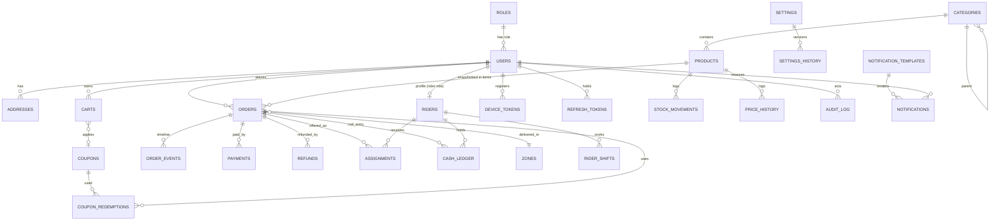

# 03 – Data Model (ERD)

Status: draft v1 · Depends on: `PLAN.md`, `01-roles-and-actions.md`, `02-workflows.md`

## 1. Conventions

- MongoDB + Mongoose. Every document has `_id` (ObjectId), `createdAt`, `updatedAt`. Collections below omit these.
- **Money:** integer paise (`price: 4500` = ₹45.00). **Weight:** integer grams. **Dates:** UTC. **Phones:** E.164.
- Every business collection carries `storeId` (single store at launch; future multi-store). Omitted from tables for brevity.
- **Embed** when data is owned by the parent and read together (variants, order items, address snapshot). **Reference** when shared or queried independently.
- **Snapshots:** orders copy product name, variant label, price, GST, and the delivery address at placement. Later catalog edits never change past orders.
- Soft delete via `status`/`isActive` (`archived`), never hard-delete catalog or orders.
- Enums are strings; the allowed values are in the tables.

## 2. ERD

Standalone: `jobs`, `otps`, `banners`, `waitlist`.

## 3. Identity & access

### roles
| Field | Type | Notes |
|---|---|---|
| name | string, unique | `super_admin`, `admin`, `customer`, `rider` |
| permissions | string[] | Keys from `01-roles-and-actions.md`; `*` = all |
| isSystem | bool | Cannot be deleted |

### users
| Field | Type | Notes |
|---|---|---|
| roleId | ref roles | One role per user |
| phone | string | E.164; **unique** (customers, riders) |
| email | string? | Unique sparse (required for staff) |
| passwordHash | string? | Staff only |
| twoFactor | {enabled, secretEnc}? | Staff only |
| name | string | |
| status | enum | `active`, `blocked`, `deactivated`, `deletion_requested`, `deleted` |
| codAllowed | bool | Per-customer COD switch (default true) |
| blockedReason | string? | |
| notificationPrefs | {promoPush, promoWhatsApp} | Transactional always on |
| lastLoginAt | date | |
| defaultAddressId | ref addresses? | |
| internalNotes | [{text, by, at}] | Admin notes |

Indexes: `phone` unique sparse, `email` unique sparse, `roleId`.

### refresh_tokens
`userId`, `tokenHash`, `deviceInfo`, `expiresAt` (TTL), `revokedAt?`. Index `userId`, TTL on `expiresAt`.

### device_tokens
`userId`, `fcmToken` (unique), `platform`, `app` (`customer`/`rider`), `lastSeenAt`.

### otps
`phone`, `otpHash`, `purpose` (`login`), `attempts`, `expiresAt` (**TTL**), `channel` (`sms`/`whatsapp`). Index `phone`.

## 4. Customer data

### addresses
| Field | Type | Notes |
|---|---|---|
| userId | ref | Index |
| label | string | Home / Work / Other |
| line1, landmark, city, pincode | string | |
| contactName, contactPhone | string | Receiver |
| location | GeoJSON Point | **2dsphere** |
| zoneId | ref zones? | Resolved at save time |
| isDeliverable | bool | |

### waitlist
`userId?`, `phone`, `location` (Point), `createdAt`: out-of-zone interest.

## 5. Catalog

### categories
`name`, `slug` (unique), `parentId?`, `imagePublicId?` (Cloudinary), `sortOrder`, `isActive`. Indexes: `parentId + sortOrder`.

### products
| Field | Type | Notes |
|---|---|---|
| name, slug, description | string | slug unique |
| categoryId | ref | Index |
| tags | string[] | `featured`, `fresh`, … |
| images | [{publicId, alt, sortOrder}] | Cloudinary `public_id`, not URL |
| type | enum | `loose`, `packaged` |
| stockMode | enum | `pooled_weight` (loose) / `per_variant` (packaged) |
| stockGrams | int? | Pool, when `pooled_weight` |
| variants | embedded[] | See below |
| gstRate | number | Percent |
| hsnCode | string? | |
| status | enum | `active`, `inactive`, `archived` |
| isOutOfStockOverride | bool | Manual out-of-stock |
| sortOrder | int | |

**variants[]** (embedded): `_id`, `label` ("250 g"), `weightGrams`, `price`, `mrp`, `salePrice?`, `saleStart?`, `saleEnd?`, `sku` (unique), `stock?` (units, when `per_variant`), `maxQtyPerOrder?`, `isActive`.

Indexes: `slug` unique, `categoryId + status`, `variants.sku` unique sparse, text index on `name`/`tags` for search.

### stock_movements
| Field | Type | Notes |
|---|---|---|
| productId, variantId? | ref | Index `productId + createdAt` |
| mode | enum | `grams` / `units` |
| delta | int | Signed |
| balanceAfter | int | |
| reason | enum | `order`, `cancel`, `return`, `purchase`, `correction`, `wastage`, `count` |
| orderId? | ref | |
| note | string? | |
| by | ref users? | null for system |

### price_history
`productId`, `variantId`, `oldPrice`, `newPrice`, `oldMrp`, `newMrp`, `by`, `at`.

### banners
`title`, `imagePublicId`, `link` (deeplink/category/product), `sortOrder`, `startsAt?`, `endsAt?`, `isActive`.

## 6. Pricing & offers

### coupons
| Field | Type | Notes |
|---|---|---|
| code | string, unique (upper-case) | |
| type | enum | `percent`, `flat` |
| value | int | Percent or paise |
| maxDiscount | int? | Cap for percent |
| minOrder | int | Paise |
| perUserLimit | int | |
| totalLimit | int? | |
| usedCount | int | Atomic increment |
| firstOrderOnly | bool | |
| startsAt, endsAt | date | |
| isActive | bool | |

### coupon_redemptions
`couponId`, `userId`, `orderId`, `discountAmount`, `at`. Unique `(couponId, orderId)`; index `(couponId, userId)`.

## 7. Cart

### carts
| Field | Type | Notes |
|---|---|---|
| userId | ref, unique | One active cart per user |
| items | [{productId, variantId, qty}] | **No prices stored**; priced live |
| couponCode | string? | |
| addressId | ref? | |
| updatedAt | date | TTL optional (cleanup stale carts) |

## 8. Orders & payments

### orders
| Field | Type | Notes |
|---|---|---|
| orderNo | string, unique | Human-friendly, e.g. `DS-240001` |
| userId | ref | Index `userId + createdAt` |
| status | enum | `PENDING_PAYMENT, PLACED, CONFIRMED, PACKING, READY, ASSIGNED, PICKED_UP, OUT_FOR_DELIVERY, DELIVERED, CANCELLED, FAILED_DELIVERY` |
| paymentMethod | enum | `cod`, `online` |
| paymentStatus | enum | `pending, paid, failed, cod_pending, cod_collected` |
| refundStatus | enum | `none`, `pending`, `done` |
| items | embedded[] | `{productId, variantId, name, variantLabel, weightGrams, unitPrice, qty, lineTotal, gstRate, hsnCode, status: ok/unavailable, unavailableReason?}` |
| address | embedded snapshot | `{line1, landmark, city, pincode, contactName, contactPhone, location}` |
| zoneId | ref | |
| pricing | embedded | `{subtotal, discount, deliveryFee, smallOrderFee, handlingFee, tax, total, taxInclusive}` |
| couponCode | string? | |
| riderId | ref riders? | Current assignment |
| deliveryOtpHash | string? | If enabled; plain OTP shown to customer only |
| expiresAt | date? | `PENDING_PAYMENT` expiry |
| placedAt, confirmedAt, packedAt, pickedUpAt, outForDeliveryAt, deliveredAt, cancelledAt | dates | |
| cancel | {by, reason}? | |
| failedDelivery | {reason, photoPublicId?, note, at}? | |
| idempotencyKey | string | Unique per user |
| notes | [{text, by, at}] | Internal |
| source | enum | `app`, `web` |

Indexes: `orderNo` unique, `(userId, createdAt desc)`, `(status, createdAt)`, `(riderId, status)`, `(userId, idempotencyKey)` unique, `expiresAt` (for expiry job).

### order_events
`orderId`, `type` (`status_change`, `item_unavailable`, `rider_assigned`, `note`, …), `from?`, `to?`, `actor` (`{userId?, role, system: bool}`), `meta` (object), `at`. Index `(orderId, at)`.

### payments
| Field | Type | Notes |
|---|---|---|
| orderId | ref | Index |
| method | enum | `razorpay`, `cod` |
| amount | int | Paise |
| status | enum | `created, authorized, captured, failed, cod_pending, cod_collected` |
| razorpayOrderId | string? | Unique sparse |
| razorpayPaymentId | string? | Unique sparse |
| signatureVerified | bool | |
| failureReason | string? | |
| webhookEventIds | string[] | Idempotency |
| capturedAt | date? | |
| rawLast | object? | Last Razorpay payload (debug) |

### refunds
| Field | Type | Notes |
|---|---|---|
| orderId, paymentId? | ref | |
| userId | ref | |
| amount | int | |
| reason | enum | `cancelled`, `item_unavailable`, `late_payment`, `damaged_item`, `missing_item`, `other` |
| source | enum | `auto`, `customer_request`, `admin` |
| items | [{orderItemIndex, qty}]? | Which lines |
| customerNote, photos[] | | For customer requests |
| status | enum | `requested, approved, rejected, done` |
| rejectReason | string? | |
| method | enum? | `razorpay_dashboard`, `upi`, `cash` |
| reference | string? | Transaction id |
| note | string? | |
| decidedBy / markedDoneBy, decidedAt / markedDoneAt | | Audited |

Index `(status, createdAt)`, `orderId`.

## 9. Delivery, riders & cash

### riders (profile for users with role `rider`)
| Field | Type | Notes |
|---|---|---|
| userId | ref, unique | |
| photoPublicId | string? | |
| vehicle | string? | |
| status | enum | `offline`, `online`, `on_break`, `deactivated` |
| activeOrderCount | int | Maintained on assign/deliver |
| lastLocation | GeoJSON Point | **2dsphere** |
| lastLocationAt | date | For stale-ping sweep |
| lastAssignedAt | date | Fairness tie-break |
| currentShiftId | ref? | |

Indexes: `userId` unique, `(status, activeOrderCount)`.

### rider_shifts
`riderId`, `startedAt`, `endedAt?`, `breaks` [{from, to}], `endedBy` (`rider`/`admin`/`system`). Index `(riderId, startedAt)`.

### assignments (offers and history)
| Field | Type | Notes |
|---|---|---|
| orderId, riderId | ref | |
| status | enum | `offered, accepted, rejected, expired, cancelled, completed` |
| mode | enum | `auto`, `manual` |
| offeredAt, respondedAt | date | |
| offerExpiresAt | date | Sweeper index |
| assignedBy | ref users? | Admin for manual |

Indexes: `(orderId, status)`, `(riderId, status)`, `(status, offerExpiresAt)`.

### rider_location_trail (optional)
`riderId`, `orderId?`, `point`, `at`, **TTL** (e.g. 7 days). Skip at launch if not needed.

### cash_ledger
| Field | Type | Notes |
|---|---|---|
| riderId | ref | Index `(riderId, at)` |
| type | enum | `collected`, `deposit`, `adjustment` |
| amount | int | Signed: collected `+`, deposit `−` |
| orderId? | ref | For `collected` |
| balanceAfter | int | Cash in hand |
| note | string? | Required for adjustments |
| by | ref users | Rider or admin |

### zones
| Field | Type | Notes |
|---|---|---|
| name | string | |
| polygon | GeoJSON Polygon | **2dsphere** |
| isEnabled | bool | |
| deliveryFeeOverride?, minOrderOverride?, freeAboveOverride? | int? | Fall back to global settings |
| hours | {open, close}? | Optional per-zone |

## 10. Notifications & jobs

### notification_templates
`key` (e.g. `order_confirmed`), `channel` (`push`/`whatsapp`/`sms`), `title?`, `body` (with `{{vars}}`), `whatsappTemplateName?`, `language`, `isActive`. Unique `(key, channel)`.

### notifications (delivery log)
`userId`, `templateKey`, `channel`, `payload`, `status` (`queued, sent, delivered, failed`), `providerMessageId?`, `error?`, `attempts`, `sentAt?`, `orderId?`. Index `(userId, createdAt)`, `(status, createdAt)`.

### jobs (Mongo-backed queue)
`type` (`send_notification`, `expire_payment`, `reconcile`, …), `payload`, `runAt`, `status` (`pending, running, done, failed`), `attempts`, `lockedUntil?`, `lastError?`. Index `(status, runAt)`.

## 11. Settings & audit

### settings
| Field | Type | Notes |
|---|---|---|
| group | enum | `store, delivery, assignment, payments, stock, auth, app, tax, notifications` |
| key | string | e.g. `deliveryFeeMode` |
| value | mixed | Validated per key by a registry |
| version | int | |
| updatedBy | ref | |

Unique `(group, key)`. Defaults live in code; DB overrides.

### settings_history
`group`, `key`, `oldValue`, `newValue`, `by`, `at`.

### audit_log
`actorId`, `actorRole`, `action` (e.g. `orders.cancel`), `entityType`, `entityId`, `before?`, `after?`, `reason?`, `ip`, `at`. Index `(entityType, entityId)`, `(actorId, at)`.

## 12. Key indexes summary

| Collection | Index | Purpose |
|---|---|---|
| users | `phone` unique | Login |
| addresses / riders / zones | `2dsphere` | Zone check, rider proximity |
| products | `categoryId+status`, text | Browse, search |
| orders | `(userId, createdAt)`, `(status, createdAt)`, `(riderId, status)`, `expiresAt` | History, dispatch board, expiry job |
| assignments | `(status, offerExpiresAt)` | Offer sweeper |
| jobs | `(status, runAt)` | Worker poll |
| otps / refresh_tokens | TTL on `expiresAt` | Auto cleanup |
| payments | razorpay ids unique sparse | Webhook idempotency |
| coupon_redemptions | `(couponId, userId)` | Per-user limits |

## 13. Integrity rules

1. **Stock deduction** is a single atomic `updateOne` with a `$gte` guard; no transaction needed. Multi-line orders roll back earlier lines on failure (compensating `$inc`). If we later need all-or-nothing, wrap in a Mongo transaction (Atlas replica set).
2. **Idempotency:** `orders(userId, idempotencyKey)` unique; payment webhook events stored in `payments.webhookEventIds`.
3. **Single source of transitions:** only the `transition()` service updates `orders.status` and writes `order_events` in the same operation.
4. `riders.activeOrderCount` is changed only by assignment/delivery services; a nightly check reconciles it with `orders`.
5. `cash_ledger.balanceAfter` computed in a single atomic step per rider (last entry + delta) to avoid races; or recomputed by aggregation for reports.
6. Orders, payments, refunds, cash ledger and audit log are **append-mostly**: no hard deletes.
7. Account deletion anonymises `users` (phone/name/email nulled, hashed placeholder) but keeps orders and payments for accounting.

## 14. Open points

1. Keep `rider_location_trail` at launch or only `lastLocation`? (Default: only `lastLocation`.)
2. Invoice numbering: separate `invoices` collection with sequential numbers (needed for GST invoices) or use `orderNo`? (Check with CA; default `orderNo`.)
3. Search: Mongo text index is enough at launch; move to Atlas Search later if catalog grows.
