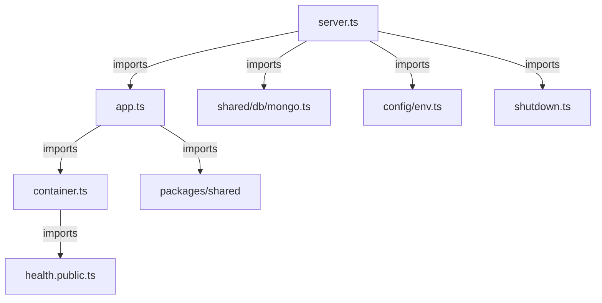

# Module dependency rules

The composition root connects dependencies. Modules expose intentional public contracts instead of importing each other's private models. This prevents one feature from bypassing another feature's validation or owning writes.

## Current graph



Arrows denote imports, not network calls. Runtime readiness is injected into health by the server/app/container path.

## Executable enforcement

[Dependency-cruiser configuration](../../apps/api/.dependency-cruiser.cjs) checks the API source tree. Runnable from root with dependencies installed:

```powershell
pnpm check:boundaries
```

Expected: no forbidden dependencies and exit code zero. This is a local command, not evidence of an installed CI gate.

| Rule | Checked behavior |
| --- | --- |
| `no-cycles` | Circular imports fail |
| `no-unresolved` | Unresolved imports fail, except the documented shared-package resolver exception |
| `module-public-only` | Cross-module imports target `.public.ts` files |
| `domain-inward` | Domain paths cannot import module application/infrastructure/interface paths, configured shared DB/HTTP or Express/Mongoose paths |
| `application-inward` | Application paths cannot import module infrastructure/interface paths |
| `interface-no-infrastructure` | Interface paths cannot directly import module infrastructure paths |
| `shared-no-modules` | Shared API infrastructure cannot import feature modules |

The checker uses TypeScript precompilation dependencies. Type-only imports still participate in architecture. Rules use path patterns: they do not prove that a function lacks hidden global state, that dynamic loading is safe or that authorization runs. Source review remains required.

`@darjeeling/shared` is excluded from unresolved-import analysis because of the current workspace resolver behavior. Its exports are instead checked by the TypeScript build. No source alias is configured; do not describe alias validation as implemented.

## Future module graph

Identity, access, audit, settings and geography are proposed in the [foundation plan](../../tasks/plan.md). Identity owns user writes, access owns role policy, and geography owns location records. These responsibilities are proposed architecture until the owning modules exist. Avoid translating documentary F01/F02 dependencies into circular code imports; inject public operations through composition.

When adding a dependency, review the caller, public contract, owning write and failure path. If the checker needs an exception, document the exact gap and removal condition rather than disabling the whole rule.
