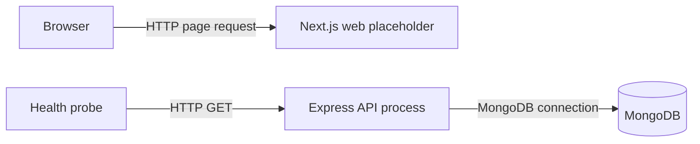

# System architecture

Status: Implemented foundation; business capabilities remain proposed.
Owner: Backend maintainers
Last verified: 2026-11-05, source and configuration inspection.
Scope: API, web placeholder, database lifecycle and module composition.

## Purpose and context

Darjeeling Stores plans a single-vendor quick-commerce service with warehouse-specific inventory, customer ordering and salaried rider operations. The [product overview](../00-overview.md) targets an initial roughly 50 orders per day, six riders, one zone and one or two warehouses. Those are planning assumptions, not measured capacity.

The current code serves process health and database readiness. It does not yet enforce the proposed authentication, payment, stock or delivery rules. A successful foundation check is not business acceptance.

## Applications and runtime topology

Arrows represent runtime calls. The web placeholder makes no implemented API request. Customer and rider mobile clients are future applications, not deployed nodes. The intended backend remains a modular monolith with a single API instance; no Redis, worker queue or socket service is implemented.

## Startup and request flow

1. [Server bootstrap](../../apps/api/src/server.ts) validates environment configuration. Invalid fields are named without echoing their values.
2. Mongo connects before HTTP listening, using a five-second server-selection timeout.
3. [Application composition](../../apps/api/src/app.ts) installs request identification/logging, CORS, JSON parsing, the health router, a fallback 404 and safe error handling.
4. [Container wiring](../../apps/api/src/container.ts) supplies the database-readiness function to the health module. The health module has no Mongoose dependency.
5. A request receives a generated UUID in `X-Request-Id`; its finished response produces a structured request log.

## Data and consistency

There are no production business models or write endpoints yet. The database helper owns connection lifecycle, not business persistence. Disposable integration tests exercise unique indexes and transaction rollback using test collections. Those tests establish database capabilities, not implemented order consistency. See [persistence](data-model.md).

## Failures and recovery

Invalid configuration and failed initial database connection prevent listening. Runtime readiness reports unavailable when Mongoose is not connected; it does not execute a fresh database query. Liveness remains independent of the database.

SIGINT and SIGTERM trigger one shutdown attempt. The server first stops accepting requests and waits for HTTP closure, then disconnects Mongo. A ten-second deadline bounds that work; failure logs `shutdown_failed` and terminates with a nonzero exit. Process-level graceful signal verification is excluded on Windows.

No request retry, provider fallback, business job repair or crash compensation exists. These need explicit feature designs before business writes are introduced.

## Security boundaries

JSON bodies are limited to 100 KB. CORS emits credential permission only for configured exact origins. CORS is a browser response-sharing policy; it does not authenticate requests or replace CSRF protection. No session, permission, rate-limit or CSRF middleware is implemented.

Logs omit request paths, query strings, headers and bodies. Internal errors return generic messages. Database URIs belong in server runtime configuration, never shared exports or public web variables. The local Compose database is unauthenticated and loopback-bound; production access controls remain a deployment prerequisite.

## Deployment and tradeoffs

Deployable artifacts are compiled API output and a Next.js production build, with their runtime dependencies. There is no checked-in production image, hosting configuration or CI release pipeline. [Deployment guidance](../engineering/build-and-deploy.md) names the missing operational decisions.

One API process keeps initial operations simple. Future in-memory caches or limits would need explicit reconsideration before multiple replicas. A single-node development replica set enables transactions but does not provide production availability.

## Related references

- [Dependency rules](module-dependencies.md) and [module anatomy](../engineering/module-anatomy.md).
- [Current API](../api/README.md) and [health capability](../features/health-and-readiness.md).
- [Foundation plan](../../tasks/plan.md), which owns proposed next capabilities.
