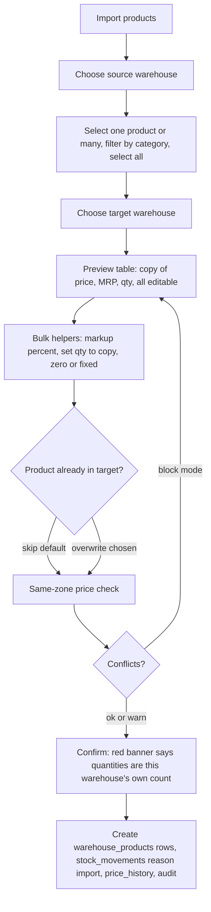

# F06 – Product Import & Admin Product Tree

Status: draft v3 · Folder: catalog · Depends on: F04, F05 · See also: F03 (warehouses), F24 (images)

## 1. Purpose
Let admins see a warehouse's whole catalog as a tree, edit price and quantity inline or in bulk, and copy products from another warehouse instead of re-entering them.

## 2. Actors
Admin or warehouse manager with `warehouse_catalog:manage` and `catalog:import`. Scoped staff only see their own warehouses (F02).

## 3. Product tree

1. Admin picks a warehouse → tree: **Category → Product → Variants**.
2. Columns: price, MRP, sale price, quantity (grams for loose), on/off.
3. Edit inline, or select many and bulk-edit (set, ±%, ±amount; set or add quantity).
4. Every edit writes `price_history` or `stock_movements`, an audit entry, and bumps the row `rev` so customers receive it through delta sync (F05, F08).
5. **Same-zone price rule:** saving a price that differs from the same product in another warehouse of the **same zone** is blocked (or warned, per `zonePriceConflictMode`). The dialog offers "apply to the other warehouse too".

## 4. Import from another warehouse

| Rule | Detail |
|---|---|
| What is copied | Product link, variants, images, price, MRP, sale price, quantity. All editable before saving |
| No sync | The source is untouched and there is no ongoing link. No stock transfer |
| Quantity mode | `copy` (default, as requested), `zero`, or `fixed`. Quantities show in red and need an explicit confirm, because copied quantities create "paper stock" until corrected |
| Existing product | `skip` (default) or `overwrite` |
| Same zone | The price rule applies. Different zone: prices can differ |
| Not in master | A product missing from the master catalog cannot be imported; create it in F04 first |
| Images | Reused by reference, not duplicated |

## 5. Screens (admin)
Warehouse picker · product tree with inline edit · bulk edit panel · import wizard (source → select → target → preview → confirm) · import result summary.

## 6. API
`GET /admin/warehouses/:id/tree` · `PUT /admin/warehouse-products/:id` · `POST /admin/warehouse-products/bulk` · `POST /admin/import/preview {sourceWarehouseId, targetWarehouseId, productIds[], options}` · `POST /admin/import/commit`.

## 7. Data
No new collection. Writes `warehouse_products` (with `importedFrom`), `stock_movements`, `price_history`, `audit_log` (owners: F05, F25).

## 8. Settings
`zonePriceConflictMode` · import defaults (`quantityMode`, `onConflict`).

## 9. Permissions
`warehouse_catalog:view`, `warehouse_catalog:manage`, `catalog:import` (🔒).

## 10. Open questions
1. Should the import default quantity be `zero` instead of `copy` to avoid overselling? Currently `copy` as requested.
2. Bulk import by CSV file (phase 3).
