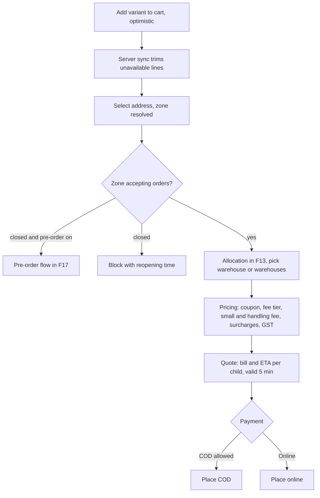

# F10 – Cart & Quote

Status: draft v3 · Folder: customer · Depends on: F05, F08, F09, F11 · See also: F13 (placement), F21 (offline cart and idempotency)

## 1. Purpose
Build the cart instantly on the device, then lock a server-priced **quote** (bill + ETA) that the order must be placed from.

## 2. Flow

1. **Add to cart:** + / − update the local cart and MMKV immediately with a light haptic. Mutations sync in the background (`PUT /cart`).
2. **Server sync:** the server trims lines that are out of stock or above max quantity; the app shows a non-blocking toast on the card.
3. **Quote:** server allocates warehouses (F13), prices the cart (F11), computes ETA per child (F20) and stores it with an expiry (~5 min).
4. **Checkout sheet:** a bottom sheet with address, ETA per delivery, payment choice and a Pay/Place button, designed to finish in a few taps.
5. **Place order:** `POST /orders {quoteId}` with an `Idempotency-Key` (F13).

## 3. Rules

| Rule | Detail |
|---|---|
| Server prices only | Clients display totals; the server's total is final |
| Quote lock | `POST /orders` needs a valid `quoteId` |
| Quote changed | If prices, fees or surcharges changed since the quote → `409 QUOTE_CHANGED` with the new quote; the customer must accept |
| Checks | Minimum order (zone), max items, per-item max quantity, COD cap/eligibility, stock, store open/paused |
| Free-delivery bar | "Add ₹X more for FREE delivery" uses the next fee tier (F11) |
| **Zone change** | If the delivery address is in a different zone than the cart was built in: re-price every line against the new zone catalog, remove or flag unavailable lines (non-blocking), show the new total, and require the customer to confirm before a new quote |
| Split notice | If allocation needs 2 warehouses the cart shows "arrives in 2 deliveries, one bill, one delivery fee" |
| Cart storage | Server-synced (needed for zone change and abandoned-cart reminders, F23) |
| Cart prices | Never stored in the cart; priced live |
| Idempotency | The key is created when the checkout sheet opens and reused on retry (F21) |

## 4. Screens (customer)
Cart (items, steppers, free-delivery bar, split notice, coupon row, bill details) · coupon list · checkout sheet · pre-order slot picker (F17) · payment confirming (F15).

## 5. API
Full request and response reference with examples: [API · F10](../api/F10-cart-and-quote.md).

`GET/PUT /cart` · `POST /cart/coupon` · `DELETE /cart/coupon` · `POST /quotes {addressId, couponCode?, scheduledWindow?}` · `GET /quotes/:id`.

## 6. Data

**carts**: `userId` (unique), `items[{productId, variantId, qty}]`, `couponCode?`, `addressId?`, `zoneId?`, `clientRev`, `updatedAt`, `reminderSentAt?`.

**quotes**

| Field | Notes |
|---|---|
| userId, addressId, zoneId | |
| cart | Snapshot of lines |
| allocation | `[{warehouseId, lines[]}]` |
| pricing | `{subtotal, discount, charges[], tax, total, taxInclusive}` |
| etas | `[{warehouseId, packMin, arrivalMin, travelMin, extraMin, promisedAt}]` |
| scheduledWindow? | For pre-orders |
| expiresAt | TTL about 5 min |
| usedByGroupId? | |

## 7. Settings
`quoteValiditySeconds` (300) · `maxItemsPerOrder` (40) · `maxQtyPerItem` (10).

## 8. Permissions
`cart:view`, `cart:sync`, `cart:add_item`, `cart:update_qty`, `cart:change_variant`, `cart:remove_item`, `cart:clear`, `coupon:apply`, `coupon:remove`, `quote:get`.

## 9. Open questions
1. Allow customers to add items after ordering? Currently no (place a second order).
