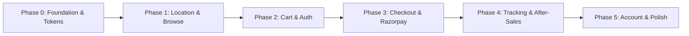

# Customer Website (`apps/storefront`) — Specification & Implementation Plan

> **Core Principle:** Exact 1:1 UI, feature, and functional parity with the Customer Mobile App (`apps/customer-app`).
> The customer app's 40 screens, quick-commerce UX patterns, visual tokens, and API contracts serve as the canonical specification for the storefront website.

---

## 1. Executive Summary & Design Direction

The storefront is a high-performance **Next.js (App Router)** quick-commerce web application. On mobile viewports, it behaves and looks **identical to the native customer mobile app** (app-like bottom navigation, floating cart bar, slide-up drawers, touch-friendly steppers). On desktop viewports, it gracefully expands into a responsive quick-commerce layout (top navigation, sticky search, side cart drawer, multi-column grid) while strictly preserving the brand identity, components, and user flows.

### 1.1 Brand Design System & UI Tokens

Matching [`customer-app/src/theme.ts`](file:///D:/Office/darjeeling_store_quickCommerce/darjeeling-stores-quick-commerce/apps/customer-app/src/theme.ts):

| Token | Hex / Value | Usage in Storefront |
|---|---|---|
| **Primary Maroon** | `#401815` | Primary buttons (Add to cart, Checkout), floating cart bar, active tab highlights |
| **Maroon Deep** | `#2a0f0d` | Hero headers, dark accents, footer background |
| **Maroon Soft** | `#5a2622` | Hover states, secondary borders |
| **Tea Yellow (Accent)** | `#ffc933` | "+" Add buttons, discount % badges, cart bar CTA, progress bar fills |
| **Tea Yellow Soft** | `#fff4d1` | Category tile backdrops, subtle card tints, coupon highlights |
| **Warm Cream (Background)** | `#f7f3ea` | Default page background |
| **Cream Deep** | `#efe8d8` | Subtle borders, dividers, skeleton shimmer base |
| **Leaf Green** | `#1f9d62` | "In Stock", "Delivered", veg mark, live status dots |
| **Green Soft** | `#e2f5ec` | Veg badge backdrop, success banners |
| **Alert Red** | `#c62828` | "Sold Out", non-veg mark, error alerts, discount badges |
| **Red Soft** | `#fdeceb` | Error chip backdrops, alert cards |
| **Amber** | `#d98a00` | Warning, store closed status, pre-order badges |
| **Amber Soft** | `#fff1d6` | Store notice banners, pre-order slot tags |
| **Ink** | `#231815` | Primary body text, headings |
| **Muted** | `#7a6f66` | Secondary labels, MRP text, pack sizes, timestamps |
| **Faint** | `#b3a99d` | Inactive icons, subtle placeholders |
| **Border / Line** | `#ece6da` | Card borders, dividers |
| **White** | `#ffffff` | Card surfaces, modals, popovers |

### 1.2 Geometry, Elevation & Motion

- **Border Radii:** `sm: 10px`, `md: 16px`, `lg: 22px`, `xl: 30px`, `pill: 9999px`.
- **Shadows:**
  - Card Shadow: `0 8px 22px rgba(64, 24, 21, 0.08)`
  - Lifted / Floating Elements: `0 14px 32px rgba(64, 24, 21, 0.18)`
- **Typography:** System font stack (`system-ui, -apple-system, 'Segoe UI', Roboto, sans-serif`), heavy 800–900 weights for hero headings and rupee amounts, tight letter-spacing on numerals. Whole paise converted via `rupees(paise)` helper.
- **Motion:** Calm, smooth ease-out curves (no spring bouncing); slide-up entrances for cards, drawer transitions for modals and cart, smooth expand/collapse for product details.

---

## 2. Layout & Responsive Adaptation Strategy

| Viewport | Navigation & Layout Patterns |
|---|---|
| **Mobile Web (< 768px)** | • Header: Location pill + store ETA, Bell icon, Cart icon with live badge<br>• Sticky search bar with rotating placeholder hints (`tea`, `snacks`, `spices`, `biscuits`)<br>• Sticky category tab strip directly under search<br>• App-style bottom navigation bar (Home, Categories, Orders, Account)<br>• Sticky floating cart bar (`N items · ₹Total · Arriving in X min | View Cart`)<br>• Modals open as bottom sheets (location, coupons, address picker) |
| **Desktop Web (≥ 768px)** | • Sticky top navbar with Brand logo, Location picker pill, wide Search input, Favourites, Account menu, Cart button<br>• Category navigation bar directly below header<br>• Two-column / grid product layouts with side filtering panel<br>• Cart opens as a sliding right-hand drawer (accessible without leaving current browsing context) or full `/cart` page<br>• Checkout and Tracking use clean 2-column card layouts (details on left, summary/map on right) |

---

## 3. Full 40-Screen & Feature Parity Specification

Every single screen and capability from the customer mobile app (`customer-app/PLAN.md`) is mapped to the storefront web routes and UI components:

```
                                      ┌──────────────┐
                                      │  Start-up &  │
                                      │   Location   │
                                      └──────┬───────┘
                                             │
                       ┌─────────────────────┴─────────────────────┐
                       ▼                                           ▼
             ┌───────────────────┐                       ┌───────────────────┐
             │ Outside Area      │                       │ Zone Resolved     │
             │ Waitlist (/outside│                       │ (/ or /location)  │
             └───────────────────┘                       └─────────┬─────────┘
                                                                   │
                                ┌──────────────────────────────────┴──────────────────────────────────┐
                                ▼                                                                     ▼
                      ┌───────────────────┐                                                 ┌───────────────────┐
                      │  Browse & Search  │                                                 │   Home Shelves    │
                      │ (/category, etc.) │                                                 │ (Banners, Rails)  │
                      └─────────┬─────────┘                                                 └─────────┬─────────┘
                                │                                                                     │
                                └──────────────────────────────────┬──────────────────────────────────┘
                                                                   │
                                                                   ▼
                                                         ┌───────────────────┐
                                                         │   Product Page    │
                                                         │  (/product/[id])  │
                                                         └─────────┬─────────┘
                                                                   │
                                                                   ▼
                                                         ┌───────────────────┐
                                                         │   Cart & Drawer   │
                                                         │      (/cart)      │
                                                         └─────────┬─────────┘
                                                                   │
                                                       (Login prompt if guest)
                                                                   │
                                                                   ▼
                                                         ┌───────────────────┐
                                                         │ Checkout & Slot   │
                                                         │    (/checkout)    │
                                                         └─────────┬─────────┘
                                                                   │
                                            ┌──────────────────────┴──────────────────────┐
                                            ▼                                             ▼
                                  ┌───────────────────┐                         ┌───────────────────┐
                                  │ Cash on Delivery  │                         │ Razorpay Checkout │
                                  │      (COD)        │                         │    (/pay/[id])    │
                                  └─────────┬─────────┘                         └─────────┬─────────┘
                                            │                                             │
                                            └──────────────────────┬──────────────────────┘
                                                                   │
                                                                   ▼
                                                         ┌───────────────────┐
                                                         │   Order Placed    │
                                                         │  (/order-placed)  │
                                                         └─────────┬─────────┘
                                                                   │
                                                                   ▼
                                                         ┌───────────────────┐
                                                         │   Live Tracking   │
                                                         │  (/tracking/[id]) │
                                                         └───────────────────┘
```

### Group A: Start-up & Location

| App Screen # | Screen / Feature | Web Route & Component | UI & Functionality Parity | API Integration |
|---|---|---|---|---|
| **1** | Splash & System Config | Global App Gate / Middleware | Checks server maintenance, minimal version, and store status. Displays maintenance screen if active. | `GET /app/config` |
| **2** | Welcome Onboarding | Modal / First-visit banner on `/` | 3 image-led slides showcasing fast delivery, local Darjeeling goods, and payment options with "Start Shopping" CTA. | Local storage |
| **3** | Location Picker & Pin | Modal & `/location` | • Draggable interactive map pin (Leaflet + OpenStreetMap)<br>• "Use Current Location" (Browser Geolocation API)<br>• City & locality manual selection fallback<br>• Saved addresses quick-select when logged in<br>• Sets `zoneId` in cookies & state | `POST /location/resolve`<br>`GET /cities`<br>`GET /localities` |
| **4** | Outside Delivery Area | `/outside` | Friendly "We're not here yet" illustration with phone number submission form to join the waitlist. | `POST /waitlist` |

### Group B: Sign-in & Authentication

| App Screen # | Screen / Feature | Web Route & Component | UI & Functionality Parity | API Integration |
|---|---|---|---|---|
| **5** | Phone Number | Modal & `/login` | +91 phone input, 10-digit validation, rate-limit warnings, seamless modal overlay so customer never loses cart context. | `POST /auth/request-otp` |
| **6** | OTP Verification | Modal & `/login/otp` | 6-digit keypad/inputs, 30s resend timer countdown, wrong-code shake animation, auto-submit on 6th digit. Native HTTP-only session cookies set automatically by API. | `POST /auth/verify-otp`<br>`POST /auth/refresh` |
| **7** | Name & Profile (New Users) | Modal & `/login/name` | First-time registration step for name and optional email, returns customer immediately back to previous intent. | `PUT /me` |

### Group C: Home & Quick-Commerce UX

| App Screen # | Screen / Feature | Web Route & Component | UI & Functionality Parity | API Integration |
|---|---|---|---|---|
| **8** | Home Screen | `/` | • **Header:** Location pill with ETA, Notification bell with unread badge, Cart icon with item counter<br>• **Rotating search placeholder:** ("Search for tea", "snacks", "spices", "biscuits")<br>• **Store status banner:** Closed countdown, paused, rain fee / night surcharge alerts<br>• **Sticky category tab strip:** Horizontal pills under search bar for quick inline category filtering<br>• **Live order card:** Pulsing live dot, multi-segment progress bar, ETA, click-to-track<br>• **Banner carousel:** Promotional banners with store ETA badge<br>• **Category grid:** 4-column (mobile) / 8-column (desktop) grid with soft tinted backdrops (`#fff4d1`, `#fde8e6`, etc.)<br>• **Offers carousel:** Ticket-style coupon cards with dashed border<br>• **Order again card:** One-tap reorder of past delivered order<br>• **Rails:** Deals (% off), Budget ("Under ₹99"), Badges (Bestseller, Organic), Brand row<br>• **Trust strip:** Fast delivery, Fresh & local, Pay your way<br>• **Sticky floating cart bar:** Bottom bar (`N items · ₹Total · Arriving in X min | View Cart`) | `GET /catalog/home`<br>`GET /banners`<br>`GET /store/status`<br>`GET /coupons/available` |
| **9** | Instant Search | `/search` & Dropdown | Debounced instant search as you type, recent search history (stored in localStorage), popular searches tags, category suggestions, "Can't find it? Tell the store" feedback. | `GET /catalog/search` |
| **10** | Notifications Inbox | Modal & `/notifications` | Bell icon opens order status updates and offer announcements; unread indicators and timestamps. | Order status feed |

### Group D: Browse & Product Catalog

| App Screen # | Screen / Feature | Web Route & Component | UI & Functionality Parity | API Integration |
|---|---|---|---|---|
| **11** | Category List | `/categories` | Full category directory with 2-column image tiles, subcategories tree, and item counts. | `GET /catalog/categories` |
| **12** | Category Products | `/category/[id]` | • Subcategory filter chips<br>• Sort dropdown (Relevance, Price: Low to High, High to Low, Discount)<br>• Filter sheet (Veg/Non-veg mark, Brand, Price range, In stock only)<br>• Product cards with quick-commerce **"+ ADD" button that morphs into `- [qty] +` stepper**<br>• Discount % chips, MRP strikethrough, store ETA badge<br>• Out-of-stock items dimmed with "Notify Me" button | `GET /catalog/products`<br>`GET /catalog/categories` |
| **13** | Brand Page | `/brand/[id]` | Brand banner/logo header with filtered product shelf. | `GET /catalog/brands`<br>`GET /catalog/products` |
| **14** | Product Detail | `/product/[id]` | • Big hero image on soft tinted circular backdrop<br>• Swipeable gallery / thumbnail strip with zoom<br>• Variant pills selector (e.g., 100g, 250g, 500g)<br>• Stepper pill (`- [qty] +`)<br>• Price, MRP, % off badge, veg/non-veg indicator<br>• Collapsible sections: Key info, Nutrition table, Storage instructions, Tags<br>• "You may also like" related products carousel<br>• Sticky bottom Add-to-cart bar<br>• Favourites toggle (heart icon) and Web Share API button<br>• SSR with OpenGraph meta tags for rich social sharing | `GET /catalog/products/:id`<br>`POST /notify-me` |
| **15** | Notify Me Subscriptions | `/account/notify-me` | List of subscribed out-of-stock items with one-tap unsubscribe. | `GET/DELETE /notify-me` |

### Group E: Cart & Checkout

| App Screen # | Screen / Feature | Web Route & Component | UI & Functionality Parity | API Integration |
|---|---|---|---|---|
| **16** | Cart | Drawer & `/cart` | • "Arriving in X minutes" ETA banner<br>• Item cards with thumbnail, variant, price, stepper, and trash icon<br>• Out-of-stock & price change warning banners<br>• Free delivery progress bar ("Add ₹X for FREE delivery")<br>• Delivery tip selector chips (₹10, ₹20, ₹30, Custom)<br>• Coupon apply row with active coupon discount tag<br>• Itemized bill: Subtotal, Delivery fee, Rain/Night surcharges, Platform fee, Taxes, Discounts, Tip<br>• Checkout CTA button | `GET/PUT /cart`<br>`GET /tips/options` |
| **17** | Coupons Sheet | Modal & `/coupons` | Type promo code or select from available coupons; shows reason if ineligible (min order, first order only, expiry). Ticket styling with dashed borders. | `GET /coupons/available`<br>`POST/DELETE /cart/coupon` |
| **18** | Saved Addresses | `/account/addresses` | Address cards with Home/Work tags, default indicator, edit and delete buttons. | `GET /addresses` |
| **19** | Add / Edit Address | Modal & `/account/addresses/new` | • Map pin with draggable marker<br>• "Use Current Location"<br>• House / Flat / Floor line<br>• **Landmark (Mandatory field)**<br>• Locality & PIN code<br>• Contact Name & Phone<br>• **House photo upload** (image file input → Cloudinary/S3 presigned URL)<br>• **Voice note recording** (Web Audio / MediaRecorder API up to 10 seconds audio recording for rider instructions)<br>• Make default checkbox | `POST/PUT/DELETE /addresses`<br>`POST /media/upload-url`<br>`POST /media/complete` |
| **20** | Delivery Time / Pre-order | Within Checkout | "Deliver now" when store is open; interactive **Pre-order slot picker** when store is closed or for next-day scheduled delivery. | `GET /preorder/slots` |
| **21** | Checkout | `/checkout` | Delivery address summary, slot picker, tip selector, full bill review, rider instructions note, and Place Order button with idempotency key. | `POST /quotes`<br>`POST /orders` |
| **22** | Payment Method Selection | Within Checkout | Choose between **Cash on Delivery (COD)** (shows exact cash to prepare) and **Pay Online** (Razorpay: UPI, Cards, Netbanking). | Part of Quote |
| **23** | Online Payment Flow | `/pay/[id]` | Razorpay Standard Web Checkout (`checkout.js`). On payment submit, transitions to "Confirming your payment..." verification polling screen. | `POST /payments/verify`<br>`GET /order-groups/:id/payment` |
| **24** | Payment Retry / Fail | Modal & `/pay/[id]` | Clear error reason, "Try Again" button, or "Switch to Cash on Delivery" if order qualifies. | `POST /payments/retry` |
| **25** | Order Placed Confirmation | `/order-placed` | Celebratory animation, order group number, delivery ETA, **4-digit delivery PIN**, split orders breakdown, and "Track Order" button. | Order confirmation state |

### Group F: Orders, Tracking & After-Sales

| App Screen # | Screen / Feature | Web Route & Component | UI & Functionality Parity | API Integration |
|---|---|---|---|---|
| **26** | Orders List | `/account/orders` | Active and Past orders tabs. Cards display order number, status chip, item thumbnail collage, total amount, one-tap "Reorder" and "Track". | `GET /orders` |
| **27** | Order Details | `/orders/[id]` | • Multi-segment status timeline (Placed → Confirmed → Packing → Out for delivery → Delivered)<br>• **4-digit delivery PIN card**<br>• Multi-warehouse split child orders breakdown<br>• Assigned rider card (name, phone call button)<br>• Complete itemized bill & payment status<br>• "Track Live", "Cancel Order", "Report Problem / Refund", "Pay Online" (for unpaid COD) | `GET /order-groups/:id`<br>`GET /orders/:id` |
| **28** | Live Order Tracking | `/tracking/[id]` & `/track/:token` | • Leaflet live map: Store pin, Customer destination pin, Rider live moving location, and route polyline<br>• Live ETA pill ("Arriving in 8 min · Updated 10s ago")<br>• 4-digit delivery PIN display<br>• Rider name and phone call button<br>• Shareable public tracking link (`/track/:token`) | `GET /orders/:id/tracking`<br>`GET /track/:token` |
| **29** | Cancel Order | Modal on Order Details | Reason selection dropdown, refund explanation for prepaid orders; enabled before warehouse packing begins. | `POST /orders/:id/cancel` |
| **30** | Refund Request | Modal & `/orders/[id]/refund` | Select specific damaged or missing items, select issue reason, upload proof photo (`refund_photo`), add customer note. | `POST /orders/:id/refund-request`<br>`POST /media/upload-url` |
| **31** | Refunds History | `/account/refunds` | List of requested refunds, current approval status, amount, and payment refund method. | `GET /refunds`<br>`GET /refunds/:id` |
| **32** | One-Tap Reorder | Action on past orders | Re-populates the customer's cart with items from a past order, alerting them of any out-of-stock items or price adjustments. | `POST /orders/:id/reorder` |

### Group G: Account & Extras

| App Screen # | Screen / Feature | Web Route & Component | UI & Functionality Parity | API Integration |
|---|---|---|---|---|
| **33** | Account Dashboard | `/account` | Customer profile overview (Name, Phone, Email), order quick links, saved addresses, favourites, notification settings, and sign-out. | `GET /me` |
| **34** | Edit Profile | `/account/profile` | Update name, email, and phone number (phone change secured via OTP verification). | `PUT /me`<br>`POST /me/phone/request-otp`<br>`POST /me/phone/verify` |
| **35** | Favourites (Wishlist) | `/account/favourites` | Grid of saved favourite products with "+ ADD" steppers to add straight to cart. | `GET/POST/DELETE /favourites` |
| **36** | Notification Preferences | `/account/notifications` | Toggle switches for order status alerts and promotional SMS / WhatsApp updates. | `GET/PUT /me/notification-prefs` |
| **37** | Help & Support | `/help` | Direct WhatsApp chat button, Support phone link, FAQ accordion, terms, privacy, and "Delete Account" request. | `GET /app/config`<br>`POST /me/delete-request` |
| **38** | Store Closed / Paused | Banner & `/closed` | Store operating hours, opening countdown timer, "Notify me when open", and "Pre-order for tomorrow" button. | `GET /store/status` |
| **39** | System Maintenance | `/maintenance` | Server maintenance notice with support contact details. | `GET /app/config` |
| **40** | Offline Banner & Fallback | Global Component | Persistent offline alert bar when browser loses internet; gracefully serves cached data. | Browser `navigator.onLine` |

---

## 4. Technical Architecture & Decisions

### 4.1 Framework & Rendering Pipeline
- **Next.js 15+ App Router** with React 19 and TypeScript.
- **SSR & ISR:**
  - Product pages (`/product/[id]`) and Category pages (`/category/[id]`) use Incremental Static Regeneration (`revalidate: 60`) for instant load times, SEO crawling, and OpenGraph social metadata.
  - Home, Search, Cart, Checkout, and Tracking are client-hydrated for instant interactive responses.
- **Routing & Rewrites:**
  - `next.config.mjs` handles `/api/v1/:path*` rewrites directly to `API_INTERNAL_ORIGIN` (`http://127.0.0.1:4000`), preserving cookie headers transparently.

### 4.2 Authentication & Sessions
- **HTTP-Only Cookies:** Supported out-of-the-box by `apps/api`. When non-native clients hit `/auth/verify-otp`, the API sets secure HTTP-only cookies (`setSessionCookies()`).
- No sensitive JWT access tokens stored in browser `localStorage`.
- Server Components access user state via request cookies, and Client Components access `/me` to hydrate session context.

### 4.3 Web Equivalents for Mobile Capabilities
1. **Interactive Maps (Address Picker & Live Tracking):**
   - Implemented using **Leaflet** with OpenStreetMap tiles (lightweight, zero API cost, responsive).
   - Draggable pin marker with reverse geocoding fallback.
   - Live tracking view renders store marker, customer marker, moving delivery partner icon, and polyline route.
2. **Delivery Voice Note:**
   - Implemented via the HTML5 **Web Audio / MediaRecorder API**.
   - Customer can tap "Record", speak up to 10 seconds of delivery instructions, preview audio playback, and upload audio via `POST /media/upload-url`.
3. **House Photo & Refund Photo:**
   - Standard HTML5 file picker with `accept="image/*"` and camera support on mobile browsers.
   - Uploads directly via presigned URLs (`POST /media/upload-url` and `POST /media/complete`).
4. **Online Payments:**
   - Integrated with **Razorpay Standard Web Checkout** (`https://checkout.razorpay.com/v1/checkout.js`).
   - Handles payment success, dismissal, and failure events seamlessly, followed by verification polling at `/pay/[id]`.

### 4.4 State Management
- **Cart Context:** Optimistic local cart synchronized with `PUT /cart`. Trims out-of-stock items, calculates subtotals, handles coupons and delivery tips.
- **Location Context:** Stores selected zone and address in cookies and localStorage; switching address triggers zone change confirmation.
- **Favourites Context:** Tracks favorited product IDs with instant optimistic heart toggle.

---

## 5. Implementation Roadmap



1. **Phase 0: Foundation & Design System (2 Days)**
   - Set up CSS tokens, typography, button kit, card kit, and theme variables in `apps/storefront`.
   - Setup React Contexts for Session, Location, and Cart.
2. **Phase 1: Location & Browse (3 Days)**
   - Header with location modal, search bar with rotating hints, and store status banner.
   - Category grid, product rails (Deals, Budget, Brands, Bestsellers), and banner carousel.
   - Product cards with morphing "+ ADD" stepper buttons.
   - Product detail page (`/product/[id]`) with image gallery and nutrition accordion.
   - Category page (`/category/[id]`) with subcategory filters and sorting.
3. **Phase 2: Cart & Authentication (3 Days)**
   - Slide-over Cart Drawer and `/cart` page with bill breakdown and delivery tip selector.
   - Phone OTP modal login flow with 6-digit auto-focus and HTTP-only session cookies.
   - Coupon drawer with ticket styling.
4. **Phase 3: Address, Checkout & Payments (4 Days)**
   - Saved address list and Address creation modal with Leaflet map pin, photo upload, and voice note recorder.
   - Checkout page with pre-order slot selector, note to rider, and payment choice (COD / Razorpay).
   - Razorpay Web Checkout integration and payment verification screen (`/pay/[id]`).
   - Order Placed celebratory page with 4-digit PIN.
5. **Phase 4: Tracking & After-Sales (3 Days)**
   - Orders list (Active / Past) with multi-warehouse split order support.
   - Live Tracking page (`/tracking/[id]`) with Leaflet live rider map and call button.
   - Order cancellation modal and Refund request form with photo upload.
6. **Phase 5: Account, Polish & SEO (2 Days)**
   - Edit Profile, Favourites wishlist, Notify-Me manager, Help & Support.
   - Responsive polish for desktop and mobile web viewports.
   - Performance testing, metadata, and accessibility audits.
