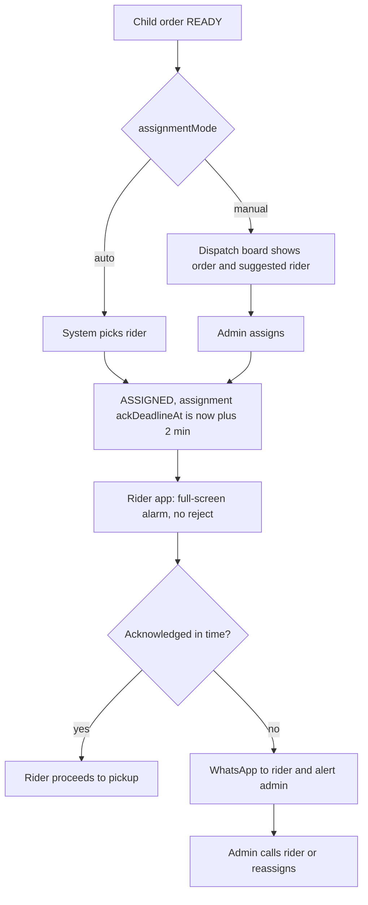

# F18 – Dispatch, Assignment & Handover

Status: draft v3 · Folder: delivery · Depends on: F13, F14, F19 · See also: F20 (ETA per stop), F21 (offline sync), F22 (cash), F23 (alarm and WhatsApp fallback)

## 1. Purpose
Get packed orders to riders quickly. **The admin or store manager assigns; riders cannot reject** (they are salaried staff). Handles batches, split orders, reassignment, handover and failed deliveries.

## 2. Assignment

| Rule | Detail |
|---|---|
| Modes | `manual` (default, board shows a suggested rider) or `auto` (system assigns without any offer) |
| Eligible / suggested rider | Active, in the order's zone, allowed at the child's warehouse (`warehouseIds`), on shift, not on break, `activeOrderCount < maxActiveOrders`, recent location ping |
| Ranking | Fewest active orders → nearest to the warehouse → least recently assigned |
| Acknowledgement | Rider must acknowledge; no ack within `ackTimeoutSeconds` (120) → WhatsApp to the rider and alert to admin |
| No reject | A rider can **report a problem** (vehicle issue, road blocked); that creates an alert, it does not unassign. The admin decides |
| Reassign | Free before `PICKED_UP`; the old rider's alarm and list update; manual action cancels any live ack timer 🔒 |

## 3. Split orders and batches

- **Split order, admin choice** (the board shows both children linked):
  - **Same rider:** one batch with stops: pickup at warehouse A → pickup at warehouse B → one drop at the customer. Offered only if the rider is allowed at both warehouses and is under the batch limit. One OTP verification delivers both.
  - **Different riders:** each child is assigned separately; each rider verifies the same group OTP.
- **Batches (general):** the admin groups orders (from one or several warehouses of the zone) for one rider, up to `maxActiveOrders` (default 2, max 3), and reorders stops. ETA per stop is computed in F20.
- A rider may switch warehouse mid-shift (F19); the admin can override.

## 4. Handover after pickup (breakdown or road block)
1. Admin starts a handover on the order → the new rider acknowledges.
2. The new rider confirms the physical hand-over; the order status does not change; events are logged 🔒.
3. If goods cannot be handed over, the rider returns to the warehouse and the order goes back to `READY`.

## 5. Failed delivery
1. Rider taps **Report failed** with a reason (customer unreachable, wrong address, refused, **road blocked, weather**, other), an optional photo and a note → `FAILED_DELIVERY`. Admin is alerted; the customer is prompted or called.
2. Admin chooses 🔒:
   - **Re-dispatch** → `READY`.
   - **Cancel and return to stock** → `CANCELLED`; stock restored for goods in good condition (`return`) or written off if spoiled (`wastage`); refund if prepaid (F16).
3. COD: nothing was collected, so no ledger entry. Repeat failures let `customers:manage` disable COD for that customer.
4. In a split group, failure of one child does not affect the other.

## 6. Dispatch board (admin)
Columns: unassigned · assigned (ack status) · out for delivery · failed. Rider list with status, active orders and zone. Alerts: unacknowledged, delayed, rider offline. The board polls `GET /admin/orders/changes?since=` every ~5 s (no sockets); a failed poll keeps the last data and shows a "reconnecting" chip.

## 7. Screens (admin)
Dispatch board · assign dialog (suggested rider, batch builder, same/different rider for split orders) · rider map · handover dialog · failed-delivery resolution.

## 8. API
Full request and response reference with examples: [API · F18](../api/F18-dispatch-and-assignment.md).

Admin: `POST /admin/orders/:id/assign {riderId}` · `POST /admin/batches` · `PUT /admin/batches/:id` (stops order) · `POST /admin/orders/:id/unassign` · `POST /admin/orders/:id/handover {riderId}` · `POST /admin/orders/:id/failed/resolve`. Rider: see F19.

## 9. Data

**assignments**: `orderId`, `riderId`, `batchId?`, `status` (`assigned, acknowledged, reassigned, cancelled, completed`; no rejected), `mode` (`manual`/`auto`), `assignedBy`, `assignedAt`, `ackDeadlineAt`, `ackAt?`, `escalatedAt?`, `whatsappSentAt?`. Index `(status, ackDeadlineAt)`.
**delivery_batches**: `riderId`, `zoneId`, `status` (`planned, active, done, cancelled`), `stops[{seq, type (pickup/drop), warehouseId?, orderIds[], status, arrivedAt?, doneAt?}]`, `createdBy`. Pickups may span several warehouses of the zone.

## 10. Settings
`assignmentMode` (`manual`) · `ackTimeoutSeconds` (120) · `maxActiveOrders` (2) · `maxOpenOrdersPerRider` (2).

## 11. Permissions
`dispatch:manage` (assign/reassign 🔒, handover 🔒), `orders:manage` (failed delivery 🔒).

## 12. Open questions
1. Maximum practical distance between two warehouses for a same-rider batch.
2. Automatic route ordering of multi-stop batches (manual in phase 2).
