# Feature: Health and readiness

Status: Implemented
Owner: Backend maintainers
Last verified: 2026-11-05, source and test inspection; runtime reruns are recorded separately.
Scope: Public process probes and database connection availability.

## User outcome

A developer or host probe can distinguish a responding HTTP process from a process whose database dependency is unavailable. This supports diagnosis and future traffic routing without exposing database credentials or topology.

## Rules and ownership

The health module owns probe response mapping. The database helper owns connection state. The composition root injects the predicate, allowing deterministic HTTP tests without a database. Bootstrap owns listening and termination.

There are no permissions on these endpoints, no business records and no writes. The health response does not certify authentication, inventory, payments or provider health.

## States and transitions

```mermaid
stateDiagram-v2
  [*] --> Validating: start process
  Validating --> Connecting: configuration valid
  Validating --> Failed: invalid configuration
  Connecting --> Listening: Mongo connected
  Connecting --> Failed: connection fails
  Listening --> Stopping: SIGINT or SIGTERM
  Stopping --> Stopped: HTTP closed and Mongo disconnected
  Stopping --> Failed: shutdown deadline or error
```

Arrows are process transitions. While listening, readiness can alternate between ready and unavailable as the injected connection state changes; liveness stays `ok` while requests can be served. Readiness is not explicitly toggled by a separate draining flag.

## Contracts

The [API reference](../api/README.md) owns endpoint/status/error details. The router receives `() => boolean`. It does not wait for an asynchronous readiness query. Any replacement predicate must preserve that synchronous contract or the router contract must change deliberately.

## Failure and concurrency

Startup connects before listening. A failed initial connection prevents normal HTTP probes because no listener exists. Once listening, unavailable readiness returns 503 rather than terminating the process.

Repeated shutdown signals are ignored after the first attempt starts. Shutdown awaits HTTP closure before database disconnect, with a combined ten-second deadline. A slow request can consume that budget; timeout leads to forced process exit through the server's error path.

## Verification

Fast tests check liveness independently of readiness and both boolean readiness results. Shutdown helper tests verify closure order and deadline rejection. Integration tests start the compiled process against a disposable replica set and verify ready responses; an unreachable target verifies failed startup. Graceful process SIGTERM is tested only on non-Windows hosts.

No provider calls, database writes or authentication checks belong in liveness. If future readiness expands, specify probe cost, timeout and failure semantics before adding more dependencies.
