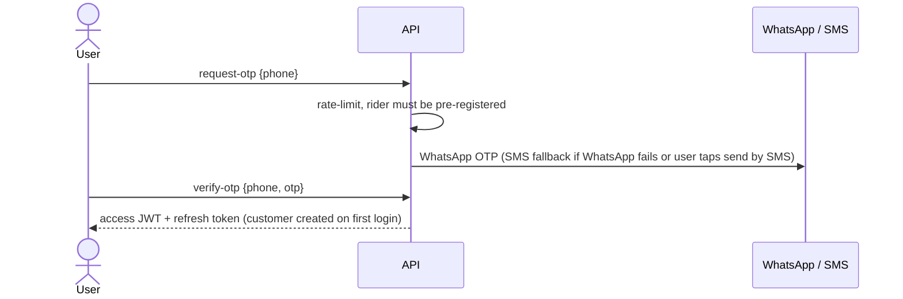

# F01 – Authentication

Status: draft v3 · Folder: foundation · Depends on: F02 (roles) · See also: F19 (rider login), F21 (offline delivery OTP)

## 1. Purpose
Log customers, riders and staff in securely. Customers and riders use phone + OTP; staff use email + password (+2FA). No passwords for customers.

## 2. Actors
Guest → customer (first login creates the account) · rider (pre-registered by admin) · admin/super_admin.

## 3. Flow

1. User enters phone → API sends a 6-digit OTP over WhatsApp, with an SMS fallback button.
2. User enters the OTP → API checks hash, expiry and attempts → returns a short-lived access JWT and a refresh token.
3. First login creates a `customer` user; the app then asks for name and the first address (F09).
4. Admin logs in on a separate endpoint with email + password (+2FA).

## 4. Rules & edge cases

| Rule | Detail |
|---|---|
| Login OTP | 6 digits (4 is too guessable), TTL ~5 min, stored hashed |
| Rate limit | `otpMaxPerHour` per phone and per IP, 429 beyond; lock the phone after max wrong attempts |
| Delivery OTP | Separate 4-digit code per order group (F13, F19). Not a login method |
| Rider | Unknown or deactivated phone → generic "not registered" (no user enumeration) |
| Admin | Lockout after repeated failures; 2FA secret stored encrypted |
| Tokens | Short access JWT; refresh token stored hashed; logout and deactivation revoke |
| Phone change | Needs OTP re-verification on the new number |
| Account deletion | Customer requests; admin finalises; user is anonymised, orders and payments kept (F25 audit) |
| WhatsApp OTP auto-read | Depends on the provider's autofill template; verify before promising it. SMS uses the SMS Retriever API |
| Rider also a customer | Not supported (one role per user, unique phone). Open point |

## 5. Screens
- **Customer:** splash with force-update and maintenance popup · phone number · OTP · name setup.
- **Rider:** splash/update check · phone number · OTP · permission setup (F19).
- **Admin (web):** email + password · 2FA code.

## 6. API (`/api/v1`)
`POST /auth/request-otp` · `POST /auth/verify-otp` · `POST /auth/refresh` · `POST /auth/logout` · `POST /admin/auth/login` · `POST /admin/auth/2fa` · `GET/PUT /me` · `POST /me/delete-request` · `POST /devices` (FCM token) · `GET /app/config` (min version, maintenance flag).

## 7. Data

**users**

| Field | Type | Notes |
|---|---|---|
| roleId | ref | One role per user (F02) |
| phone | string | E.164, unique sparse |
| email, passwordHash, twoFactor | | Staff only |
| name | string | |
| status | enum | `active, blocked, deactivated, deletion_requested, deleted` |
| scope | {all, warehouseIds[]} | Staff data scope (F02) |
| codAllowed | bool | Per-customer COD switch (F15) |
| notificationPrefs | {promoPush, promoWhatsApp, cartReminders} | Transactional always on |
| lastLoginAt, defaultAddressId, internalNotes, blockedReason | | |

`refresh_tokens`: `userId`, `tokenHash`, `deviceInfo`, `expiresAt` (TTL), `revokedAt?`.
`device_tokens`: `userId`, `fcmToken` (unique), `platform`, `app` (customer/rider), `lastSeenAt`.
`otps`: `phone`, `otpHash`, `purpose`, `attempts`, `expiresAt` (TTL), `channel`.

## 8. Settings
`loginOtpLength` (6) · `otpExpiryMinutes` (5) · `otpMaxPerHour` (5) · `otpMaxAttempts` · `minAppVersion` · `maintenanceMode`.

## 9. Permissions & notifications
Keys: `auth:request_otp` (guest), `auth:verify_otp` (guest), `auth:refresh`, `auth:logout`, `profile:view`, `profile:update`, `profile:delete_request`, `device:register_token`, `notification_pref:update`.
Notifications: login OTP via WhatsApp (SMS fallback).

## 10. Open questions
1. Can a rider also order as a customer on the same phone?
2. Confirm WhatsApp authentication template approval and one-tap autofill support with the provider.
