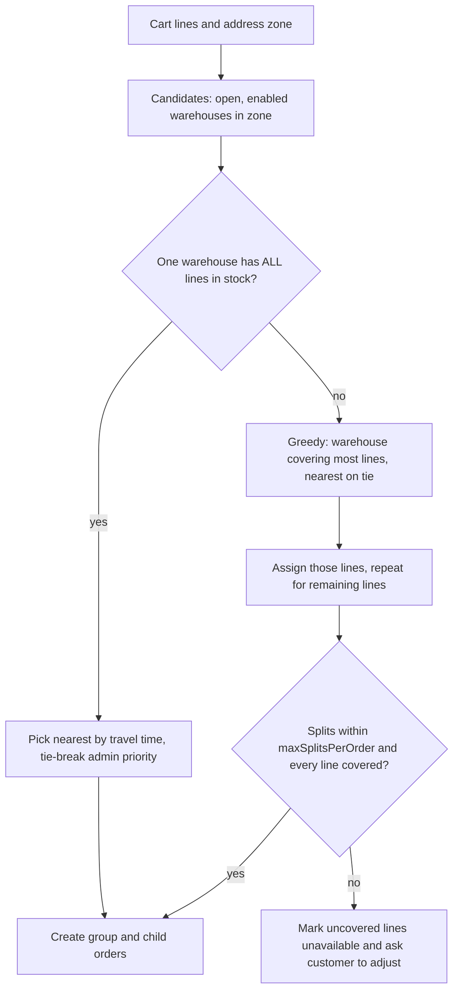

# F13 – Order Placement & Split Orders

Status: draft v3 · Folder: orders · Depends on: F05, F10, F11, F15 · See also: F14 (lifecycle), F16 (cancel), F18 (dispatch of split orders)

## 1. Purpose
Turn a quote into an order. If one warehouse cannot supply everything, split it into several child orders (one per warehouse) while the customer pays one bill and one delivery fee.

## 2. Concepts

| Term | Meaning |
|---|---|
| Order group | One checkout: one customer, address, payment, bill, delivery fee, delivery OTP |
| Child order | The part fulfilled by one warehouse; the customer sees it as an order with its own ETA and tracking |
| Normal order | A group with exactly one child |

## 3. Allocation (which warehouse)

Runs when a quote is requested and again, with stock locked, when the order is placed.

1. Distance = Google Routes travel time (cached per address and warehouse), falling back to the locality or warehouse default (F20).
2. A product stocked (same price) in several warehouses goes to the nearest one that can supply the **whole quantity**. A line is never split between warehouses.
3. `maxSplitsPerOrder` (default 2) protects dispatch. Beyond it the cart shows which lines cannot be fulfilled together.
4. The customer sees "Your order will arrive in 2 deliveries" with an ETA each. **One bill, one delivery fee, one payment, one OTP.**

## 4. Place order — COD

1. Client sends `quoteId` + `Idempotency-Key`.
2. Server re-allocates and re-prices. If it differs from the quote → `409 QUOTE_CHANGED`.
3. Atomic stock deduction per child and line (`$gte` guard; loose items deduct `weightGrams × qty` from that warehouse's pool). Any failure rolls back earlier deductions in the group and tells the customer which item is short.
4. Copy the address voice note and house photo into order-owned files (F24). Create the group (`paymentStatus=cod_pending`) and children `PLACED` with item snapshots, `amountDue`, `promisedAt`, delivery OTP (encrypted at the group, salted hash per child for the rider bundle).
5. `orderConfirmMode=auto` → children `CONFIRMED`.
6. Notify the customer (push + WhatsApp with items, bill, **delivery OTP**, tracking link) and warehouse admins (panel bell via polling + WhatsApp).

## 5. Place order — online
Same steps, but children start `PENDING_PAYMENT` with `expiresAt`; they become `PLACED` when the Razorpay webhook confirms payment. Full payment flow in F15.

## 6. Fee and discount allocation across children

| Field | Meaning |
|---|---|
| `itemsSubtotal` | Sum of the child's lines |
| `allocatedDiscount` | Pro-rata share of the coupon discount |
| `allocatedCharges[]` | Pro-rata share of fees and surcharges (for refunds and invoices) |
| `amountDue` | COD amount for this child, 0 if prepaid |

Shares are pro-rata by `itemsSubtotal`, with the rounding remainder on the first child; they sum to the group total. Cancelling a child refunds its items minus its discount share; the delivery fee and surcharges stay unless the **whole group** is cancelled before dispatch (F16).

## 7. Idempotency and numbers
- `order_groups(userId, idempotencyKey)` is unique, so a double tap or a retry returns the same order.
- `groupNo` e.g. `DS-240001`. Child `orderNo` equals `groupNo` when single, `groupNo-A`, `-B` when split.
- One delivery OTP per group: the same code is verified by whichever rider delivers each child (F19, F21).

## 8. Screens
- **Customer:** order success, order list, order detail showing each child with its own status and ETA.
- **Admin:** orders list (group and children linked), new-order bell, order detail (F14).

## 9. API
`POST /orders {quoteId}` (header `Idempotency-Key`) · `GET /orders` · `GET /orders/:id` (child) · `GET /order-groups/:id`.

## 10. Data

**order_groups**

| Field | Type | Notes |
|---|---|---|
| groupNo | string unique | |
| userId, zoneId | ref | |
| address | embedded snapshot | `{line1, landmark, locality, city, pincode, contactName, contactPhone, location, deliveryNotes?}` |
| paymentMethod / paymentStatus | enum | `cod`/`online`; `pending, paid, failed, cod_pending, cod_collected` |
| pricing | embedded | `{subtotal, discount, charges[{type,label,amount,ruleId}], tax, total, taxInclusive}` |
| couponCode, quoteId | | |
| deliveryOtpEnc | string | Encrypted 4-digit OTP shown to the customer; never sent to riders |
| expiresAt | date? | Online expiry |
| idempotencyKey | string | Unique per `(userId, key)` |
| childOrderIds | ref[] | |
| status | enum | Derived roll-up (F14) |
| source | enum | `app`, `web` |
| trackingToken | string | Expiring public tracking link (F20) |

Indexes: `groupNo` unique, `(userId, createdAt)`, `(userId, idempotencyKey)` unique, `expiresAt`.

**orders** (child)

| Field | Type | Notes |
|---|---|---|
| orderNo | string unique | |
| groupId, userId, zoneId, warehouseId | ref | |
| status | enum | `PENDING_PAYMENT, PLACED, CONFIRMED, PACKING, READY, ASSIGNED, PICKED_UP, OUT_FOR_DELIVERY, ARRIVED, DELIVERED, CANCELLED, FAILED_DELIVERY` |
| paymentStatus | enum | `pending, paid, failed, cod_pending, cod_collected, upi_unverified` |
| refundStatus | enum | `none, pending, done` |
| items | embedded[] | `{productId, variantId, name, variantLabel, weightGrams, unitPrice, qty, lineTotal, gstRate, hsnCode, status ok/unavailable, unavailableReason?}` |
| itemsSubtotal, allocatedDiscount, allocatedCharges, amountDue | | See §6 |
| riderId, batchId | ref? | Current assignment |
| deliveryOtp | {salt, hash, algo}? | Per-child salted hash for the offline bundle |
| scheduledWindow | {start, end}? | Pre-order (F17) |
| etaBreakdown, promisedAt | | F20 |
| timestamps | | `placedAt, confirmedAt, packedAt, pickedUpAt, outForDeliveryAt, arrivedAt, deliveredAt, cancelledAt` |
| voiceMediaId, housePhotoMediaId | ref? | Copies made at placement, deleted 7 days after delivery or closing (F24) |
| delivery | {offline, deviceTime, gps, accuracyM, syncedAt, otpVerifiedLocal, otpVerifiedServer, flags[], reviewStatus} | Offline delivery audit (F21) |
| collection | {method, amount, at, flags[]}? | `cash, upi_unverified, upi_verified, online`; flags `overpaid, unmatched` |
| cancel | {by, reason}? | |
| failedDelivery | {reason, photoMediaId?, note, at}? | Reasons include `road_blocked`, `weather` |
| notes | [{text, by, at}] | Internal |

Indexes: `orderNo` unique, `(groupId)`, `(warehouseId, status, createdAt)`, `(userId, createdAt)`, `(riderId, status)`, `(batchId)`, `(scheduledWindow.start)`.

## 11. Settings
`maxSplitsPerOrder` (2) · `maxItemsPerOrder` (40) · `orderConfirmMode` (`auto`) · `onlineOrderExpiryMinutes` (15).

## 12. Permissions
`order:place_cod`, `order:place_online`, `order:place_preorder`, `order:list_own`, `order:view_own`, `order:reorder`, `order:view_delivery_otp`, `order:track` (F20), `support:contact`, `feedback:rate_order` (phase 2); admin `orders:view`, `orders:manage`.

## 13. Open questions
1. Invoice per child using `orderNo`, or a separate invoices collection with per-warehouse GSTIN and sequence (CA)?
2. Maximum practical distance between warehouses for a same-rider split batch (F18).
