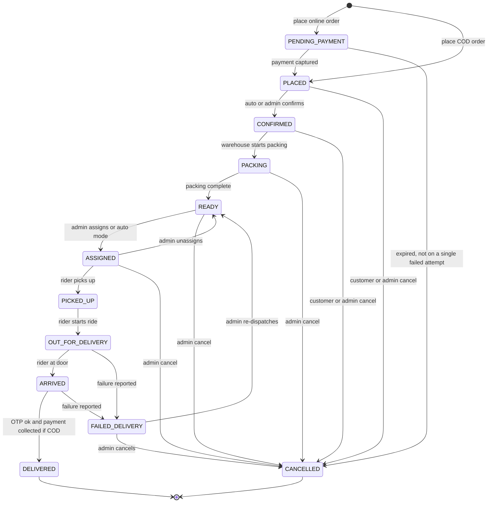

# F14 – Order Lifecycle & Packing

Status: draft v3 · Folder: orders · Depends on: F13 · See also: F15 (payment), F16 (cancel), F18 (dispatch), F19 (rider), F23 (notifications)

## 1. Purpose
Define the single state machine every child order follows, and how the warehouse confirms, packs and hands over an order, including missing or damaged items.

## 2. State machine (master)

| Rule | Detail |
|---|---|
| Customer cancel | `PENDING_PAYMENT`, `PLACED`, `CONFIRMED` (setting `customerCancelUntil`) |
| Admin cancel | Any state before `PICKED_UP`; after that use failed delivery or handover (F18) |
| Terminal | `DELIVERED`, `CANCELLED`. Refunds are records, not states |
| Single writer | `transition(order, to, actor)` is the only code that changes `status` and writes `order_events` |
| Admin override | `orders:manage` can force a status with a reason 🔒 |
| Offline delivery | `DELIVERED` with `deliveredOffline=true`; the server sets it when the event syncs (F21) |
| Single-stop shortcut | The rider app's "Picked up & Start ride" runs `PICKED_UP` then `OUT_FOR_DELIVERY` in one tap |
| Failed payment attempt | Does not cancel; only expiry cancels (F15) |

**Group status** is derived: `PENDING_PAYMENT` while unpaid · `ACTIVE` while any child is active · `DELIVERED` when all delivered · `PARTIAL` if some delivered and others cancelled · `CANCELLED` when all cancelled.

## 3. Confirmation and packing (per child, at its warehouse)

1. `PLACED → CONFIRMED`: automatic or an admin click, per `orderConfirmMode`.
2. Warehouse staff **Start packing** → `PACKING`.
3. For each line: pack it, or **mark unavailable**:
   - Remove or reduce the line, restore that warehouse's stock, recompute the bill 🔒, notify the customer.
   - The delivery fee and surcharges stay as charged (never raised).
   - Prepaid: auto-create a refund `requested` for the difference (F16). COD: the child `amountDue` is updated.
   - All lines unavailable → cancel the child.
4. **Complete packing** → `READY`; print the thermal bill and packing slip.
5. Other children of the same group proceed independently; the group ETA is the latest child's.
6. **Delay alert** if an order sits in a state longer than `slaMinutes`.

## 4. Screens (admin)
New-order bell (polling) · orders list (filters, search, group and child linked) · order detail (items, timeline, notes) · packing view (tick items, mark unavailable) · print bill/slip · force-status dialog.

## 5. API
`GET /admin/orders` · `GET /admin/orders/:id` · `GET /admin/orders/changes?since=<cursor>` (polling) · `POST /admin/orders/:id/confirm` · `/start-packing` · `/complete-packing` · `/items/:idx/unavailable` · `/cancel` · `/force-status`.

## 6. Data
**order_events**: `orderId`, `groupId`, `type` (`status_change, item_unavailable, rider_assigned, ack, handover, note, …`), `from?`, `to?`, `actor {userId?, role, system}`, `meta`, `at`. Index `(orderId, at)`.
Order and group fields: F13.

## 7. Settings
`orderConfirmMode` (`auto`/`manual`, warehouse) · `customerCancelUntil` (`CONFIRMED`) · `slaMinutes` per state (placeholder: confirm 5, pack 15, assign 5).

## 8. Permissions & notifications
Admin: `orders:view`, `orders:manage` (mark unavailable 🔒, edit items 🔒, cancel 🔒, force status 🔒).
Notifications: confirmed, item unavailable / bill changed (customer); new order and delay alerts (admin). See F23.

## 9. Open questions
1. Does each packer log in separately (scoped Packer role) or share one admin device? Deferred.
