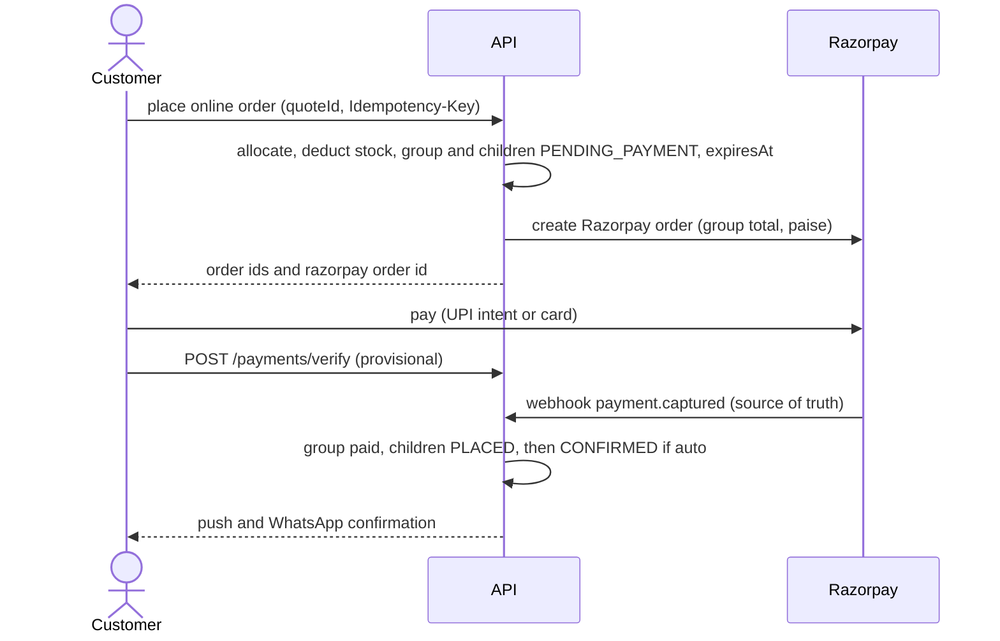

# F15 – Payments

Status: draft v3 · Folder: orders · Depends on: F13 · See also: F16 (refunds), F19 (doorstep), F21 (offline QR), F22 (cash)

## 1. Purpose
Take payment by UPI/online (Razorpay), cash on delivery (COD), pay-online-link for a COD order, and a UPI QR at the doorstep.

## 2. Methods

| Method | Flow |
|---|---|
| **UPI / online (Razorpay)** | Group + Razorpay order → client checkout (UPI intent opens GPay/PhonePe/Paytm) → server verifies the signature, the **webhook is the source of truth** → children `PLACED` only when paid. Unpaid orders expire after N minutes and stock is restored |
| **COD** | Children `PLACED` immediately (subject to COD cap and rules). Each child has an `amountDue`. The rider collects cash or UPI and marks it collected |
| **Pay-online link for COD** | Before cash is collected, the customer can pay the group via a Razorpay link or UPI intent |
| **UPI QR at doorstep** | The rider app builds a `upi://pay` QR on the device; recorded as `upi_unverified` until the admin reconciles with the bank |

## 3. Online payment flow

| Case | Handling |
|---|---|
| Webhook before client verify | Fine; verify is idempotent |
| Client says success, no webhook | Stay `PENDING_PAYMENT` ("confirming payment") until the webhook or reconciliation |
| Payment failed | Customer may retry on the same group until `expiresAt`; **only expiry cancels** |
| Not paid by `expiresAt` | Cancel all children, restore stock |
| Duplicate webhook | Ignored via stored event id |
| Amount mismatch | Flag the admin, do not confirm |
| Paid after cancel or expiry | Refund `late_payment` and alert (F16) |

## 4. Pay-link race (customer pays while the rider has the order)
On `payment.captured` for a COD group: the group becomes `paid`, each child `amountDue = 0`, and the rider app shows **"Already paid – do not collect"** (FCM data message and the next assignments poll). If the rider is offline and collects anyway, the sync records the entry as `overpaid` and the admin creates a refund (F16, F21).

## 5. UPI at the door
- QR is built locally: `upi://pay?pa=<vpa>&pn=<payeeName>&am=<rupees, 2 decimals>&cu=INR&tn=<orderNo>` (F21). No API call.
- The app cannot confirm payment. The rider taps "Customer paid via UPI" → `collection.method = upi_unverified`. It is **not** cash in hand (F22).
- The admin reconciles with the bank statement and marks `upi_verified` or raises a discrepancy.
- Use a **business** UPI ID; a personal VPA for commercial collection may breach UPI rules (confirm with your bank). When online, the app can show a Razorpay QR or link instead, which is verifiable.

## 6. Reconciliation
Daily job compares Razorpay payments with our DB and flags mismatches. Admin can mark a stuck payment paid after checking the Razorpay dashboard 🔒.

## 7. Rules
- Idempotency keys on order creation and on webhooks; never trust client-side payment success.
- Fixed-price variants mean the bill does not change with weighing, so COD and Razorpay amounts stay exact.
- COD eligibility: cap `codMaxAmount`, per-zone enable, per-customer `codAllowed` (disabled after repeated failed deliveries, F18).

## 8. Screens
- **Customer:** payment choice in the checkout sheet · UPI intent handoff · "Confirming payment" · retry · pay-online link for COD.
- **Admin:** payments list (status, Razorpay ids) · reconciliation results · stuck-payment action.

## 9. API
`POST /payments/verify` · `POST /payments/retry` · `POST /orders/:id/pay-link` · `POST /webhooks/razorpay` · admin `GET /admin/payments` · `POST /admin/payments/reconcile` · `POST /admin/payments/:id/mark-paid`.

## 10. Data
**payments**: `groupId`, `method` (`razorpay`, `cod`, `razorpay_link`), `amount`, `status` (`created, authorized, captured, failed, cod_pending, cod_collected`), `razorpayOrderId` / `razorpayPaymentId` / `paymentLinkId` (unique sparse), `signatureVerified`, `failureReason`, `capturedAt`, `webhookEventIds[]`, `rawLast`.
Payment flags on orders and groups: F13.

## 11. Settings
`codEnabled`, `codMaxAmount` (₹2000), `onlineEnabled`, `onlineOrderExpiryMinutes` (15), `payLinkForCodEnabled` (on).

## 12. Permissions
Customer: `payment:verify`, `payment:retry`, `payment:pay_online_link`. Admin: `payments:view`, `payments:manage` (🔒).

## 13. Open questions
1. Razorpay payment-link fees versus UPI intent for the pay-later case.
2. Business VPA ownership and bank reconciliation routine.
