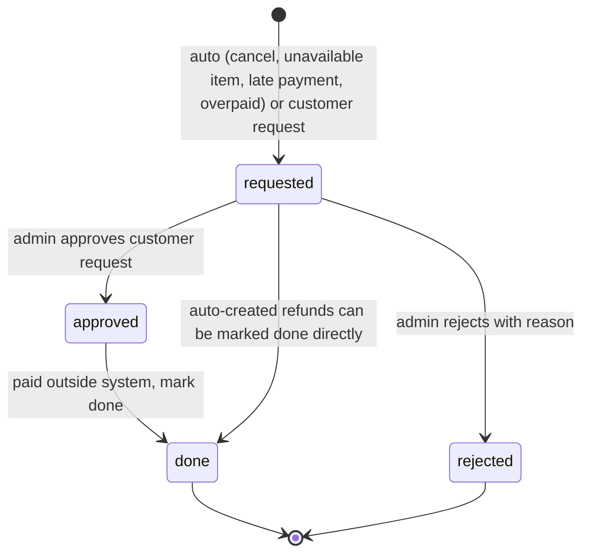

# F16 – Cancellations & Refunds

Status: draft v3 · Folder: orders · Depends on: F13, F14, F15 · See also: F18 (failed delivery), F22 (cash)

## 1. Purpose
Cancel orders cleanly, restore stock, and refund customers manually and traceably.

## 2. Cancellation

| Who | When | Result |
|---|---|---|
| Customer | child in `PENDING_PAYMENT`, `PLACED`, `CONFIRMED` | That child `CANCELLED`, its stock restored; prepaid → refund of its item share |
| Admin | before `PICKED_UP` (including `READY` and `ASSIGNED`) | Same, reason required 🔒; live assignment cancelled and the rider notified |
| System | unpaid online group past expiry | Cancel all children, restore stock |

**Split groups:** cancelling one child refunds `itemsSubtotal − allocatedDiscount` for that child. The delivery fee and surcharges remain (the delivery still happens) unless **all** children are cancelled before dispatch, in which case the whole bill is refunded. Coupon redemption is released only when the whole group is cancelled.

Notify the customer on every cancel; paid cancellations appear in Pending refunds.

## 3. Refunds are manual (v1)

1. **Created** automatically (prepaid cancel, unavailable item, late payment, overpaid) or by the customer (`refund:request`: item, reason, photo if required) within `refundWindowHours` after delivery and for allowed categories.
2. Admin reviews the **Pending refunds** list (amount, reason, photos, order).
3. Customer-requested refunds: approve or reject with a reason (customer is notified).
4. Admin pays back **outside the system**: Razorpay dashboard for online orders, UPI or cash for COD.
5. Admin clicks **Mark refund done** (method, reference, note) → `done`, order `refundStatus=done`, `markedBy/markedAt` 🔒; the customer is notified (push + WhatsApp).
6. Window expired → request blocked in the app, or auto-rejected per setting.

A "Refund via Razorpay" API button can be added later without changing the data model.

## 4. Screens
- **Customer:** cancel confirmation · refund request (item, reason, photo) · refund status inside order detail.
- **Admin:** pending refunds list · refund detail with photos · approve/reject · mark-done dialog.

## 5. API
`POST /orders/:id/cancel` · `POST /orders/:id/refund-request` · `GET /refunds` · admin `GET /admin/refunds` · `POST /admin/refunds/:id/approve` · `/reject` · `/mark-done`.

## 6. Data
**refunds**: `groupId`, `orderId?`, `paymentId?`, `userId`, `amount`, `reason` (`cancelled, item_unavailable, late_payment, damaged_item, missing_item, overpaid, other`), `source` (`auto, customer_request, admin`), `items?`, `customerNote`, `photoMediaIds[]`, `status` (`requested, approved, rejected, done`), `rejectReason?`, `method?` (`razorpay_dashboard, upi, cash`), `reference?`, `note?`, decided/markedDone by and at. Index `(status, createdAt)`, `orderId`.

## 7. Settings
`refundWindowHours` (24) · `refundPhotoRequired` (on) · `refundEligibleCategories` (perishables) · `media.evidenceRetentionDays` (90).

## 8. Permissions & notifications
Customer: `order:cancel_own`, `refund:request`, `refund:view_own`. Admin: `refunds:manage` (create/approve/reject/mark done 🔒), `orders:manage` (cancel 🔒).
Notifications: cancelled, refund created/approved/rejected/done (push + WhatsApp); admin pending-refund badge (F23).

## 9. Open questions
1. Wallet or store-credit refunds (the Google doc mentioned it)? Not in v1.
2. Evidence photo retention (placeholder 90 days).
