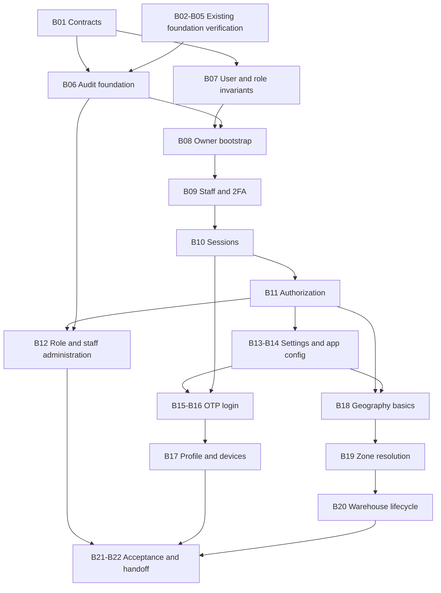

# Backend foundation implementation plan

Status: Proposed implementation expansion for F01–F03
Owner: Backend maintainers; product/security decisions require the responsible business owner
Last verified: 2026-11-05, feature/API designs, current source and existing task checklist inspected
Scope: Backend F01 authentication, F02 access/staff and F03 geography, with required audit/settings support

This revision expands the same unfinished foundation initiative. Existing B01–B22 identifiers remain valid; detailed execution slices are appended to [todo.md](todo.md). No business implementation is delivered by this plan. The decisions and acceptance gates below take precedence over older ambiguous planning prose; current behavior remains described in the [architecture reference](../docs/architecture/overview.md).

Status: proposed, 2026-11-05. Execution checklist: [todo.md](todo.md). This refines [Dev 1](../dev1.md) foundation work; no business implementation is included in this planning change.

## Scope and baseline

The original baseline was a minimal Express health scaffold. The working tree now includes validated configuration, safe HTTP middleware, MongoDB lifecycle/readiness, local replica-set configuration, disposable integration tests, health module composition and dependency checks. Authentication, authorization, settings, audit and geography remain planned. See [current architecture](../docs/architecture/overview.md) and [testing](../docs/engineering/testing.md) for current behavior and verification limits. This plan retains proposed work and is not a release-completion record.

Build F01 authentication, F02 permissions/staff and F03 geography, plus the minimum F25 settings/audit and F23 OTP transport needed by those features. Keep one API instance, MongoDB/Mongoose, TypeScript and Zod. Retain current pnpm commands and `packages/shared`; no Redis or BullMQ. Exclude storefront/mobile screens, catalog, checkout, delivery, media and full notification jobs from this increment.

## Architecture

Use `src/config/env.ts`, `src/shared/{db,http,logging}`, `src/modules/{health,identity,access,settings,audit,geography}`, and explicit `container.ts` / `routes.ts`. Keep `app.ts` independent of listening and connecting to Mongo. Introduce module folders as their first behavior lands, not empty class templates.

Each business module exposes `<module>.public.ts`; domain logic must not import Express/Mongoose. Application actions use small ports where real database/provider dependencies exist; adapters live in infrastructure and HTTP validation/mapping in interface. Pure operations remain functions. Enforce cross-module and layer imports with dependency checks, including relative and type-only imports.

Data owners: identity owns users, OTPs, refresh/device tokens; access owns roles; geography owns cities/localities/zones/warehouses; settings owns overrides/history; audit owns audit_log. Identity owns user writes, including staff edits. Access evaluates supplied actor identity and scope without importing identity internals. Wire cross-module operations in the container; avoid F01/F02's documentary circular dependency becoming a code cycle.

## Proposed decisions before coding

- Maintain one role per phone/account; rider/customer dual use remains unsupported.
- Seed roles idempotently; never overwrite administrator-edited permissions on ordinary startup. Bootstrap the first owner through an explicit command with operator-supplied credentials, no demo password.
- Admin uses short-lived access tokens and an HTTP-only refresh cookie; native clients receive refresh tokens for secure storage. Restrict CORS to configured origins and enforce CSRF/origin protections for cookie-authenticated mutations. Final cookie settings depend on deployment domains.
- Require owner 2FA. Implement enrollment/confirmation, challenge expiration, replay protection and audited recovery/reset; a password-only challenge is not an authenticated session.
- Rotate refresh tokens with atomic single use and explicit token-family revocation/replay handling. Concurrent refresh behavior must be documented for clients.
- Check OTP expiry in the query, not via eventual TTL deletion. Consume successfully verified OTPs atomically; distinguish login and phone-change purposes. Never log or return OTPs in production. Inject a fake transport only in isolated tests.
- Zone-level mutations require all-scope access initially; explicit zone grants are deferred because the specified user scope only models warehouses. Individual warehouse scope does not confer zone-wide authority.
- Settings resolve warehouse → zone → global → default only for keys whose registry permits those scopes. Keep warehouse hours/timers on warehouse records for F03, and reconcile the duplicate F25 registry entries before implementation.
- Reject positive-area zone overlap; permit shared boundaries with deterministic point-on-boundary resolution. Serialize geometry mutations across instances of the write operation so concurrent saves cannot bypass the check. Test containment and invalid polygons, not just intersecting edges.
- Warehouse disable and zone reassignment need order/rider dependency checks once those modules exist. Until authoritative checks are wired, reject those operations conservatively; do not ship an always-false active-order stub.

Record agreed decisions in the owning specs during task 1. These are proposed technical choices, not changes already made to the requirements.

## Ordered delivery

1. Runtime/configuration and HTTP contracts.
2. Real Mongo connection/indexes and isolated integration tests.
3. Module boundaries and audit foundation.
4. Roles, users and secure owner bootstrap.
5. Staff authentication, 2FA and session lifecycle.
6. Permission enforcement and staff/role management.
7. Scoped settings and application configuration.
8. Customer/rider OTP, profile and device-token endpoints.
9. Geography administration and location resolution.
10. End-to-end backend acceptance and developer handoff.

Each numbered stage has smaller checklist entries in todo.md. Deliver tests alongside each behavior; do not build every model first and attach behavior at the end.

## Verification and handoff

Use existing `pnpm build`, `pnpm typecheck`, `pnpm test`. Add an explicit API `test:integration` script backed by an isolated disposable Mongo replica set and a guard that refuses non-test databases. Add actual lint/boundary commands rather than documenting nonexistent checks. Fast tests must not require live providers. Real integration tests cover TTL semantics, unique indexes, conditional writes, refresh replay and geospatial behavior.

Final demonstration: bootstrap owner → complete 2FA login → create scoped staff → create city/zone/warehouse → verify staff cannot access another warehouse → update a scoped setting → customer OTP login → resolve an inside/outside location → revoke session and prove subsequent access fails.

Provider sandbox OTP delivery is a separate release gate from fake-adapter tests. Database readiness must fail when Mongo is unavailable while liveness retains its existing meaning. Verify compiled API startup and bounded shutdown.

## Inputs and risks

Need WhatsApp/SMS provider choice and credentials through environment configuration (never chat), template approval, deployed web/API domains, and owner bootstrap/2FA recovery ownership. Local infrastructure and fake-provider tests can proceed before these inputs; production authentication cannot be called ready without them.

Money/quote contradictions listed in dev1.md remain outside this foundation increment. Real zone polygons and operating values are supplied before live use; test fixtures must remain clearly separate. No schedule commitment until runtime/database/provider setup is verified.

## 1. Implementation baseline and completion boundary

The current API exposes only health and readiness. Runtime configuration, safe errors, request IDs, Mongo lifecycle, local replica-set configuration, isolated integration scaffolding and dependency checks exist. They should be verified and reused, not rebuilt. No F01, F02 or F03 business endpoint, production business model or feature-specific test exists.

| Capability | Planned endpoint count | Completion definition |
| --- | --- | --- |
| F01 | 16 in the current design table | All listed routes plus reconciled enrollment/challenge contracts, persisted sessions and negative security cases |
| F02 | 15 in the current design table | Registry, role/staff administration, immediate authorization changes and scoped audit integration |
| F03 | 18 in the current design table | Validated geography, deterministic resolution, scoped warehouse operations and conservative lifecycle guards |

Counts are traceability aids, not acceptance evidence. Additional challenge/recovery operations must be reflected in the API inventory when contracts are finalized.

Excluded: storefront/admin/mobile screens, full rider onboarding and shifts, catalog, order allocation, payments, media, notifications beyond OTP transport, production hosting and full F25 reports/account anonymization. The minimal audit, settings and rider-eligibility dependencies below are included because the three features cannot safely function without them.

## 2. Contract reconciliation before dependent coding

These are proposed defaults, not silently approved business policy. B01 resolves them in the owning feature/API documents and records any owner decision. Independent infrastructure verification may proceed while external inputs remain pending.

| ID | Proposed decision | Why / affected contract | Resolution owner and blocking work |
| --- | --- | --- | --- |
| D01 | Preserve direct health/readiness success bodies and server-generated request UUIDs; business success bodies use `data` | Avoid breaking existing probes; fix conventions that promise incoming-ID echo and universal envelopes | Backend; blocks B01 completion |
| D02 | Browser refresh uses HTTP-only cookies; native refresh uses explicit tokens in secure storage | Separate transport without exposing browser refresh credentials through JSON | Backend + web; blocks browser sessions |
| D03 | Owner bootstrap grants only an expiring, purpose-bound enrollment credential until 2FA succeeds | Password-only enrollment must not access normal admin operations | Backend + owner recovery custodian; blocks B08/B09 |
| D04 | Retain password + `totpCode` login compatibility; bind any enrollment/recovery challenge to user, purpose, expiry and single use | Existing API has no complete restricted-state contract | Backend; exact challenge endpoints finalized in B01 |
| D05 | Refresh replay revokes the affected token family; administrative force-logout/deactivation revoke all user sessions | API currently promises user-wide replay revocation; either choice requires explicit client behavior | Backend + client maintainers; blocks B10 |
| D06 | One active OTP challenge per normalized phone, purpose and app; resend supersedes the previous challenge | Prevent cross-purpose use and ambiguous concurrent verification | Backend; add opaque challenge identity or equivalent explicit binding before B16 |
| D07 | Initial staff/role administration is restricted to the owner's administrative authority; arbitrary delegation is deferred | Prevent `staff:manage` becoming permission to create an owner or broaden scope | Owner + backend; blocks B12 |
| D08 | System-role set and editable fields are explicit; seeds create missing records without overwriting administrator changes | Resolve whether launch `admin` is system-protected and distinguish deletion protection from edit policy | Owner + backend; blocks B07/B12 |
| D09 | Zone-wide writes require all-scope authority; warehouse grants never imply zone grants | No explicit zone-grant model exists | Backend; blocks B11 geography policy |
| D10 | Shared-border resolution chooses the enabled candidate with lowest stable identifier, consistently across calls | Adjacent zones may both contain the same border point | Product + backend; confirm before B19 |
| D11 | Locality and linked zone must share a city; public lists exclude inactive records and inactive parents | Avoid inconsistent picker/resolution behavior | Product + backend; blocks B18/B19 |
| D12 | Initial `deliverable` means an enabled, unpaused geographic zone match; warehouse opening/stock eligibility is evaluated separately | Do not claim order availability from geography alone | Product + backend; align F08/F17 before B19 |
| D13 | Store warehouse address as a structured value; select required fields before schema creation | Feature model says embedded address while examples use a string | Product + backend; blocks warehouse contract |
| D14 | Reject warehouse zone reassignment initially; reject unsafe disable when authoritative order/rider checks are unavailable | No fake dependency check may assert that operations are safe | Backend + delivery owner; blocks B20 completion |
| D15 | Maintain one phone/account role; rider login requires an active preregistered rider identity | Customer creation must never promote an account based on client `app` | Product + backend; blocks B16 rider path |
| D16 | Maintenance exempts liveness, readiness, public app config and narrowly defined recovery/admin operations | Blanket 503 on every other route would prevent operator recovery | Product + backend; blocks B14 maintenance enforcement |

Cookie domain/SameSite/Secure settings depend on real web/API origins. OTP delivery provider, fallback behavior, template approval and recovery custodian cannot be inferred from repository files. Record these as explicit inputs, not guessed production values.

## 3. Module ownership and intended files

Create files when their behavior lands; the paths below are placement guidance rather than a request for empty folders.

| Owner | Records/actions | Expected locations |
| --- | --- | --- |
| Identity | Users, password/2FA verification, OTP challenges, refresh sessions, device ownership, profile writes | `apps/api/src/modules/identity/{domain,application,infrastructure,interface}`, `identity.public.ts` |
| Access | Permission registry, roles, grant policy, resource-scope decisions | `apps/api/src/modules/access/...`, `access.public.ts` |
| Audit | Redacted append-only events and authorized reads | `apps/api/src/modules/audit/...`, `audit.public.ts` |
| Settings | Typed registry, allowed-scope overrides/history, public config projection | `apps/api/src/modules/settings/...`, `settings.public.ts` |
| Geography | Cities, localities, zones, warehouses and geographic queries | `apps/api/src/modules/geography/...`, `geography.public.ts` |
| Composition | Concrete adapters, shared transaction/session context and public operations | Existing `container.ts`, `app.ts`, `server.ts` |
| Shared transport | Client-safe DTOs and error types actually consumed across applications | `packages/shared/src` |

Identity owns all user mutations, including staff edits requested through access administration. Access consumes a trusted actor description rather than importing identity private models. Geography cannot read future order/rider collections directly; it receives an explicit dependency-check operation when available. Audit should accept safe event fields and an optional transaction context, not arbitrary raw request or document dumps.

Use existing Mongoose, Express, Zod, Vitest and composition patterns. Evaluate a maintained password/TOTP/JWT or geometry library only when needed, against its official documentation and installed dependency inventory; do not hand-roll cryptography or robust polygon algorithms. Record selected packages and operational requirements at implementation time.

## 4. Persistence and security invariants

### Users, roles and bootstrap

Normalize email and E.164 phone before writes. Establish partial unique indexes for present canonical values; absent identifiers must not collide through stored nulls. Define the deleted-account identifier reuse policy before account deletion changes identifiers. Persist explicit staff/customer/rider classification independently of user-editable role labels so renaming a role cannot change account type.

Seed the permission registry and missing launch roles idempotently. Fail clearly on incompatible registry/seed drift; never overwrite production role edits on ordinary boot. Bootstrap is an operator command, not a public HTTP route. It receives secrets through an appropriate local secret input, refuses owner replacement and handles two concurrent attempts safely through a unique bootstrap invariant/transaction. Never pass a password in shell command arguments or commit a default account.

### Sessions and 2FA

Use explicit issuer/audience/algorithm validation and bounded token lifetime. Persist hashed refresh credentials with family, predecessor/replacement, expiry and revocation state. Rotate using a transaction or atomic compare-and-set strategy that permits one winner. Treat legitimate simultaneous refresh as a documented client serialization problem; the chosen replay response must not silently mint two valid successors.

All protected requests check current account/session validity and effective authorization so logout, deactivation and administrative changes have the promised immediate effect. A stateless access JWT alone does not provide that behavior. Decide the exact session/version lookup and cache invalidation implementation before B10/B11.

Encrypt TOTP secrets with server-managed key material and a versioned encryption format; define missing/rotated-key failure behavior. Restrict setup/reset/confirmation by purpose and recent proof. Prevent accepted TOTP timestep replay where required by the finalized contract. Do not log secrets, enrollment URLs, OTPs or credentials. Enrollment secret disclosure is limited to its authorized setup response.

### OTP and abuse limits

Use cryptographic randomness and a keyed verification hash appropriate to low-entropy OTPs; keep the key outside Mongo. Expiry and remaining attempts are checked during verification, not delegated to eventual TTL deletion. Atomically consume successful challenges and atomically increment failed attempts. Challenge supersession and account creation must remain correct under concurrency.

Apply phone and trusted-IP limits to OTP request/verify and staff login. Define counters, windows, retries and bounded storage. Failed OTP/provider requests must not provide an unlimited bypass of abuse controls. A generic error message alone does not prove absence of account enumeration; review status, response shape and provider/timing behavior.

### Audit and consistency

For a mandatory audited mutation, commit the audit record and business write in the same database transaction. If audit cannot be recorded, the mutation fails. Use explicit allowlists for before/after fields and omit tokens, password hashes, OTP/TOTP material and provider credentials.

Record actor, action, target, warehouse scope where relevant, UTC timestamp, reason when required and request ID. Public APIs cannot edit/delete audit records. Session invalidation must not fail silently after a sensitive mutation; define a transactional validity version or equivalent durable mechanism instead of relying solely on a best-effort cache notification.

### Geometry and lifecycle

Validate finite/ranged coordinates, GeoJSON order, closed rings, minimum distinct points, nonzero area and self-intersection. Limit payload vertices and supported geographic extent deliberately; document the supported single-ring polygon model rather than accepting unsupported holes or MultiPolygons.

Overlap enforcement needs a shared serialization point: use a transaction that first updates a stable geography write-lock/version record, then rechecks candidates and commits the zone mutation. Retry transaction conflicts with a bounded policy. Every polygon edit and enable operation follows the same path. A process-local mutex alone is insufficient against another writer; ordinary Mongo transactions without a shared conflict record do not prevent write skew.

Test the chosen geometric method against containment, identical polygons, shared edges/vertices and actual indexed Mongo queries. Define how zone pause/inactive-city state affects resolution and whether expired pauses are treated inactive without waiting for cleanup.

## 5. Endpoint-to-delivery traceability

Paths below are relative to `/api/v1`. Each route needs input/path/query validation, safe output projection and documented failure behavior, even if several routes share an action.

| Delivery slice | Endpoints / operation | Required negative cases |
| --- | --- | --- |
| B08/B09 | Owner CLI; `/admin/auth/login`; `/admin/auth/2fa/setup`, `/enable`; finalized challenge/recovery contracts | Duplicate bootstrap, wrong password/code, expired/reused challenge, incomplete enrollment, unauthorized reset |
| B10 | `/auth/refresh`, `/auth/logout`; JWT middleware | Wrong signature/issuer/audience, expired/revoked credentials, refresh race/replay, cookie CSRF and cross-user logout |
| B11/B17 | `GET /me/access`, `GET /me`, `PUT /me` | Missing actor, disabled account, role/scope/status injection, unsafe staff email changes |
| B12 | `GET /admin/permissions`; list/create/detail/update/delete `/admin/roles` | Unknown keys, wildcard grant, system protection, in-use deletion, concurrent assignment/deletion |
| B12 | List/create/detail/update `/admin/staff`; deactivate/reactivate/reset-password/reset-2fa/force-logout | Owner escalation, foreign scope, self-lockout policy, immediate revocation and mandatory audit |
| B14 | `GET /app/config`; minimal settings read/update/history support | Secret leakage, unsupported app/platform/version, maintenance lockout and scope precedence |
| B15/B16 | `/auth/request-otp`, `/auth/verify-otp` | Provider fallback, rate/attempt cap, expiry, resend, double consume, wrong-purpose/app and unregistered rider |
| B17 | `/me/phone/request-otp`, `/me/phone/verify`, `/me/delete-request` | Used phone, stolen challenge, same phone, concurrent change and lifecycle/session policy |
| B17 | `POST /devices`, `DELETE /devices/:fcmToken`; existing notification-preference contract | Another account's token, token reassignment policy, invalid platform/app and token rotation |
| B18 | Public `/cities`, `/localities`; admin list/create/update cities/localities | Inactive parents, foreign city-zone references, duplicate normalized names and invalid coordinates |
| B19 | Admin list/create/detail/update zones | Invalid/contained/identical polygons, concurrent overlap, re-enable conflict and unauthorized zone writes |
| B19 | `/location/resolve`, `/zones/check` | Neither/both point and locality, boundary tie, paused/disabled zone, invalid/unknown locality |
| B18/B20 | Admin list/create/detail/update warehouses | Scope escape, duplicate canonical code, bad timers, address shape, zone reassignment and unsafe disable |
| B06/B12 | Scoped `GET /admin/audit` (F25-owned support) | Missing permission, foreign scope, secret fields, invalid cursor/filter and unauthorized audit mutation |

For combined API examples, split list/detail output shapes explicitly. Define strict accepted fields for each mutation; profile edits cannot modify role, scope, status or staff credentials. Resolve self-service staff email change as an authenticated identifier change rather than treating it as an unprotected profile field.

## 6. Ordered delivery and checkpoints

Detailed task records are in [todo.md](todo.md). Dependencies follow this sequence:



Arrows mean prerequisite completion. Basic geography may be implemented after authorization while OTP provider approval is pending. Do not add task parallelism that introduces conflicting edits to shared contracts, composition or lockfiles without coordination.

### Checkpoint A: foundation and contracts

Current health/readiness behavior remains compatible. B01 discrepancies are reconciled, foundational tests run, import checks reject intended violations and source examples match current error/request-ID behavior. Record remaining Docker/POSIX evidence separately.

### Checkpoint B: secure staff access

Bootstrap owner, enroll 2FA, log in, refresh, log out and prove prior session access fails. Reused/expired enrollment credentials fail. Database and logs contain no plaintext password, OTP or refresh token. Encryption keys are validated at startup and never printed.

### Checkpoint C: authority and administration

Create a restricted staff account and prove both list and direct-ID warehouse denial. Role/scope changes and deactivation take effect immediately. In-use/system role protection and last-owner rules hold under concurrent requests. Audit failure rolls back sensitive writes.

### Checkpoint D: customer/rider identity

Customer first login creates one account under concurrent verify; repeat login creates none. Unknown/blocked rider cannot enter customer creation accidentally. Phone-change purpose cannot authenticate a new session. Logout/device ownership and provider failure cases pass. Fake transport and actual sandbox delivery evidence are recorded separately.

### Checkpoint E: geography

Create city, locality, zone and warehouse through authorized routes. Resolve inside/outside/border/paused points. Concurrent overlapping saves cannot both succeed. Scoped staff cannot operate on another warehouse, and unresolved order/rider dependencies cause guarded rejection rather than permission to disable.

### Checkpoint F: final acceptance

Perform the complete integrated backend journey against an isolated replica set and compiled server. Update current references, finalized API examples, environment classification and checklist evidence. No item becomes complete merely because a plan or schema file exists.

## 7. Verification strategy and commands

Runnable PowerShell commands from repository root with dependencies installed; build shared before focused API execution. Integration tests require process creation and may download a Mongo binary:

```powershell
pnpm --filter @darjeeling/shared build
pnpm test
pnpm typecheck
pnpm check:boundaries
pnpm --filter @darjeeling/api test:integration
pnpm build
```

Expected: each exits zero, with intentional skips explicitly recorded. Execute sequentially and stop on failure. These are existing commands; proposed new focused tests should run under existing Vitest scripts rather than fictitious root commands.

| Test layer | Required cases |
| --- | --- |
| Pure policy | Permission/grant/scope decisions, field projections, business-time windows, polygon validity and boundary tie rules |
| HTTP | Exact route inventory, validation/errors/request ID, missing/invalid actor, cookie/header transport and forbidden field rejection |
| Real database | Partial unique indexes, atomic OTP/refresh, role assignment/deletion race, audited transactions, settings revisions and geospatial writes |
| Process | Missing secrets/configuration, unavailable DB, ready/unready transitions and supported-host termination |
| Provider sandbox | Actual OTP send/fallback/template outcomes with safe provider references; never required for ordinary fast tests |

Use controllable clocks for expiry boundaries, not minutes-long sleeps. Use barriers/concurrent requests to reproduce races rather than assuming serial tests prove atomicity. Never point cleanup at an arbitrary environment URI. Include test fixtures for distinct actors with the same permission but different warehouses.

Mobile UI tests are outside this backend plan. If later added, inspect actual devices/screens with ARTEMIS before authoring executable interactions; fake backend tests do not establish Android/iOS behavior.

## 8. Configuration, rollout and rollback

Introduce only configuration required by a landed slice: password/TOTP/JWT keys and issuer/audience, public origins/cookie policy, OTP verification key/provider credentials and bootstrap operator input. Names are finalized with implementation and listed in `.env.example` with requiredness and server runtime classification. Do not add a production fake-OTP switch or a default owner password.

Before a stateful release, establish reviewed index initialization, authenticated database access, backups/restore evidence and deployment ownership. Seed changes are additive and idempotent. Any destructive data migration requires a separate affected-data and rollback plan; none is authorized by this implementation plan.

Application rollback can leave newly written users/sessions/roles/settings/geography behind. Preserve backward-compatible fields and index changes where possible. If credential formats or token validation change incompatibly, document forced reauthentication. Reverting code does not revoke leaked credentials, unsend OTPs or reverse external effects.

## 9. Risks, inputs and release gates

| Risk/input | Mitigation | Completion gate |
| --- | --- | --- |
| Unresolved browser domains | Finalize cookie and trusted-origin policy in staging | Browser sessions cannot be production-ready without actual-origin tests |
| Owner loses 2FA | Define recovery custodian, proof and audit policy before enrollment release | No unrestricted reset endpoint or hidden bypass |
| OTP provider/template unavailable | Implement fake adapter in isolated tests and continue independent slices | Real delivery remains blocked and explicitly unverified |
| Geography algorithm mismatch | Validate library and Mongo behavior with shared-edge/containment fixtures | Both policy and actual query behavior agree |
| Role or scope staleness | Durable validity/version strategy with explicit cache invalidation | Old authority fails on the next protected request |
| Missing order/rider dependency services | Conservative lifecycle rejection | Unsafe warehouse changes remain unavailable |
| Single-instance assumption changes | Revisit abuse counters, caches and write serialization | No extra API replicas until consistency assumptions are reviewed |
| Unverified operating values | Require real polygons, hours and owner-approved policy inputs | Test fixtures never become silent production defaults |

No duration estimate is committed. Size each slice after resolving its inputs and library choices; split any slice that cannot be reviewed and verified in one focused session. Source review, local integration results, provider delivery and staging operations remain distinct forms of evidence.

## F02 implementation expansion — 2026-11-06

Use [the detailed F02 completion plan](f02-implementation-plan.md) for the remaining role/staff APIs, concurrency/audit safety and admin UI work. It is grounded in pulled `origin/main` at `1d2d920`, including the new catalog/offerings modules and their default-deny auth integration. Its ordered F02-01–F02-18 checklist is appended to [todo.md](todo.md). Existing foundation tasks and historical evidence are retained.
